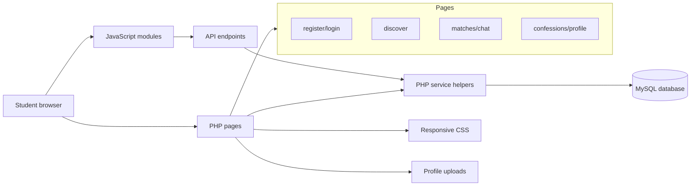
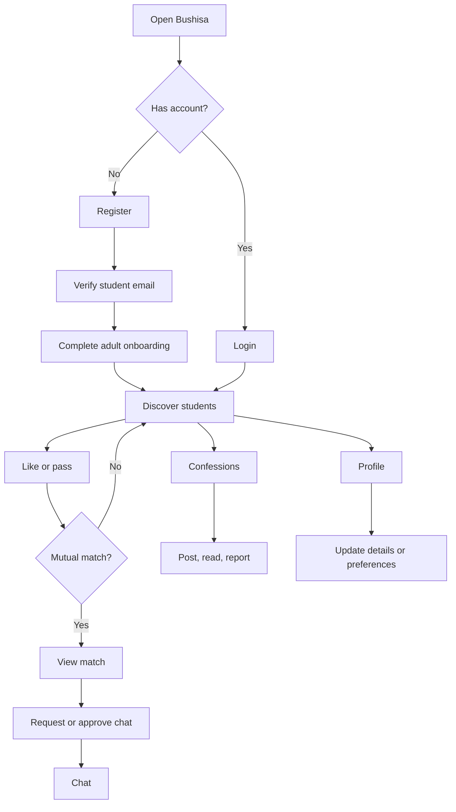
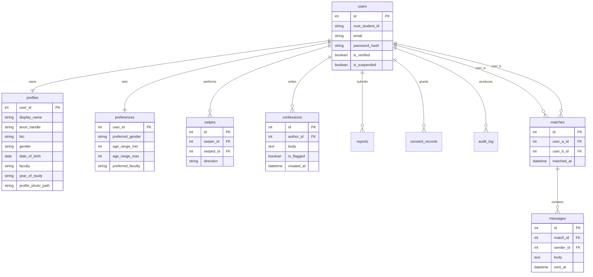
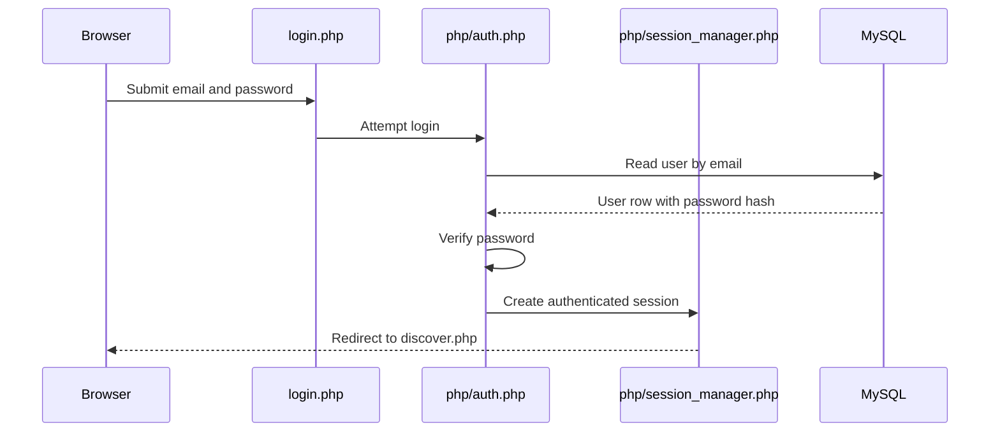

# Bushisa

Bushisa is a responsive student matching and campus interaction website built for the SCS 2114 Internet and Web Development mini group project. The platform demonstrates a complete PHP/MySQL web application with registration, secure login, navigation, forms, JavaScript interactivity, database-backed CRUD operations, responsive design, accessibility considerations, and browser-focused testing.

The project brief is stored in [docs/Web Development Group Mini Project.docx](docs/Web%20Development%20Group%20Mini%20Project.docx). This README presents Bushisa only against the requirements in that brief.

## 1. Project Purpose

Bushisa is designed for NUST students who want a safer, student-only way to discover other students, express interest, chat after a match, and participate in a campus confession board. The website is not just a static brochure; it is an interactive platform where users can create accounts, sign in, complete onboarding, update profiles, browse candidates, like or pass candidates, manage matches, send messages, and create or manage confessions.

Core idea:

- Only student-style accounts can register.
- Users must log in before using the main website.
- Matching happens through profile and preference data.
- Messaging is available through match and permission flows.
- Confessions provide a separate campus discussion feature.
- Safety actions such as reporting, blocking, and account deletion are included.

## 2. Mini Project Requirement Coverage

| Project guideline | Bushisa implementation | Main files |
|---|---|---|
| Functional mini website for a service | Student matching and campus interaction platform | [index.php](index.php), [discover.php](discover.php), [matches.php](matches.php), [confessions.php](confessions.php) |
| HTML5 pages | Server-rendered PHP pages output HTML5 documents | [php/frontend.php](php/frontend.php), page files in the project root |
| CSS styling | Custom responsive stylesheet | [css/style.css](css/style.css) |
| Navigation menus | Authenticated bottom/side navigation with Home, Confessions, Find Match, You | [php/frontend.php](php/frontend.php) |
| Forms | Registration, login, email verification, onboarding, profile editing, matching questionnaire, chat, confession posting, account deletion | [register.php](register.php), [login.php](login.php), [verify_email.php](verify_email.php), [onboarding.php](onboarding.php), [profile.php](profile.php), [matches.php](matches.php), [chat.php](chat.php), [confessions.php](confessions.php), [account_delete.php](account_delete.php) |
| JavaScript | Form validation, fetch helpers, toast messages, discovery cards, chat refresh, confession UI | [js/app.js](js/app.js), [js/auth.js](js/auth.js), [js/discover.js](js/discover.js), [js/chat.js](js/chat.js), [js/confessions.js](js/confessions.js) |
| Framework or dependency tooling | Composer-managed PHP dependencies and Playwright testing framework. The web UI itself is custom PHP/CSS/JS rather than a large MVC framework. | [composer.json](composer.json), [package.json](package.json), [playwright.config.js](playwright.config.js) |
| Form validation | Client-side validation plus server-side validation | [js/auth.js](js/auth.js), [php/auth.php](php/auth.php), [php/password_policy.php](php/password_policy.php), [php/signup_verification.php](php/signup_verification.php) |
| Database connectivity | PDO MySQL connection and environment-based database settings | [config/db.php](config/db.php), [config/database_settings.php](config/database_settings.php) |
| User registration/account creation | Student account creation with password hashing, profile creation, preferences, and verification state | [register.php](register.php), [php/auth.php](php/auth.php) |
| Secure login | Password verification, sessions, login guard, current user checks | [login.php](login.php), [php/auth.php](php/auth.php), [php/session_manager.php](php/session_manager.php) |
| Password protection | Password hashing and password strength policy | [php/password_policy.php](php/password_policy.php), [php/auth.php](php/auth.php) |
| Session management | Protected pages require login and current account state | [php/session_manager.php](php/session_manager.php) |
| At least 4 interconnected pages excluding user management | Discover, Matches, Chat, Confessions, Profile | [discover.php](discover.php), [matches.php](matches.php), [chat.php](chat.php), [confessions.php](confessions.php), [profile.php](profile.php) |
| Images or multimedia | Profile photo upload/display and avatar fallback UI | [profile.php](profile.php), [php/upload_validator.php](php/upload_validator.php), [public/uploads](public/uploads) |
| Basic CRUD operations | Users, profiles, preferences, swipes, matches, messages, confessions, reports | [api](api), [database/bushisa.sql](database/bushisa.sql) |
| Responsive design | Mobile-first layout with media queries for tablet/desktop | [css/style.css](css/style.css) |
| Accessibility and usability | Labels, ARIA attributes, keyboard focus states, semantic navigation, status messages | [php/frontend.php](php/frontend.php), [css/style.css](css/style.css), [js/auth.js](js/auth.js) |
| Basic security practices | Prepared SQL statements, CSRF tokens, password hashing, session validation, output escaping | [php/csrf.php](php/csrf.php), [php/frontend.php](php/frontend.php), [php/session_manager.php](php/session_manager.php), [api](api) |
| Testing across screen sizes/browsers | Playwright browser tests and PHP integration/unit checks | [tests](tests), [tests/browser/p0-rendered-flows.spec.js](tests/browser/p0-rendered-flows.spec.js) |

## 3. Platform Overview

Bushisa has three main user areas:

1. Account and onboarding area  
   A student registers, verifies their student email, signs in, and completes adult onboarding.

2. Matching area  
   A signed-in student browses profiles, sets preferences, answers matching questions, likes or passes candidates, and views accepted matches.

3. Interaction and safety area  
   Matched users can chat when the permission flow allows it. Users can also post confessions, report content, block another user, edit their profile, or delete their account.

## 4. System Design Diagram



Explanation:

- Browser pages are rendered by PHP files such as [discover.php](discover.php), [matches.php](matches.php), [chat.php](chat.php), and [confessions.php](confessions.php).
- JavaScript modules in [js](js) add interactivity and call JSON endpoints in [api](api).
- Shared PHP helpers in [php](php) handle authentication, sessions, matching, validation, safety, and database operations.
- MySQL stores users, profiles, preferences, swipes, matches, messages, confessions, reports, audit logs, and consent records.
- [css/style.css](css/style.css) controls the responsive visual design.

## 5. User Journey



Files supporting this flow:

- Registration: [register.php](register.php), [php/auth.php](php/auth.php)
- Email approval: [verify_email.php](verify_email.php), [php/signup_verification.php](php/signup_verification.php)
- Login: [login.php](login.php), [php/session_manager.php](php/session_manager.php)
- Discover: [discover.php](discover.php), [api/discover.php](api/discover.php), [api/swipe.php](api/swipe.php)
- Matches: [matches.php](matches.php), [api/matches.php](api/matches.php), [api/message_requests.php](api/message_requests.php)
- Chat: [chat.php](chat.php), [api/messages.php](api/messages.php), [js/chat.js](js/chat.js)
- Confessions: [confessions.php](confessions.php), [api/confessions.php](api/confessions.php)
- Profile: [profile.php](profile.php), [php/upload_validator.php](php/upload_validator.php)

## 6. Main Website Pages

### Public and User Management Pages

| Page | Purpose |
|---|---|
| [index.php](index.php) | Entry point that sends users toward the application. |
| [register.php](register.php) | Creates a new student account and profile. |
| [verify_email.php](verify_email.php) | Lets a user enter the approval code sent to their student email. |
| [login.php](login.php) | Authenticates existing users. |
| [logout.php](logout.php) | Ends the session. |
| [onboarding.php](onboarding.php) | Collects adult eligibility information before full access. |
| [terms_of_service.php](terms_of_service.php), [privacy_policy.php](privacy_policy.php), [community_guidelines.php](community_guidelines.php) | Public policy pages linked from the account flow. |

### Interconnected Main Pages

These satisfy the "at least 4 interconnected pages excluding user management pages" requirement.

| Page | What the lecturer should see |
|---|---|
| [discover.php](discover.php) | Candidate discovery cards and filters. Users can like or pass other profiles. |
| [matches.php](matches.php) | Match list, matching questionnaire, and chat request/approval states. |
| [chat.php](chat.php) | Conversation page for approved matches, with message composer and thread display. |
| [confessions.php](confessions.php) | Campus confession feed where users can post and view confessions. |
| [profile.php](profile.php) | Profile update page for display information, preferences, and profile photo. |

## 7. Forms Used in the Application

| Form | Type of processing | Files |
|---|---|---|
| Registration form | Validates student email, student number, password, profile fields, then inserts user/profile/preference records | [register.php](register.php), [php/auth.php](php/auth.php), [js/auth.js](js/auth.js) |
| Login form | Verifies email and password, then creates an authenticated session | [login.php](login.php), [php/auth.php](php/auth.php) |
| Email code form | Confirms the student email approval code | [verify_email.php](verify_email.php), [php/signup_verification.php](php/signup_verification.php) |
| Adult onboarding form | Verifies date of birth before active access | [onboarding.php](onboarding.php), [php/signup_verification.php](php/signup_verification.php) |
| Profile form | Updates display name, bio, faculty, preferences, and profile photo | [profile.php](profile.php), [php/upload_validator.php](php/upload_validator.php) |
| Matching questionnaire | Stores answers used by the matching logic | [matches.php](matches.php), [api/questionnaire.php](api/questionnaire.php), [php/matching/questionnaire.php](php/matching/questionnaire.php) |
| Swipe controls | Records like/pass actions | [discover.php](discover.php), [api/swipe.php](api/swipe.php), [js/discover.js](js/discover.js) |
| Message form | Sends chat messages | [chat.php](chat.php), [api/messages.php](api/messages.php), [js/chat.js](js/chat.js) |
| Confession form | Creates a confession post | [confessions.php](confessions.php), [api/confessions.php](api/confessions.php), [js/confessions.js](js/confessions.js) |
| Account deletion form | Confirms and processes account deletion | [account_delete.php](account_delete.php), [api/account.php](api/account.php), [php/anonymiser.php](php/anonymiser.php) |

## 8. Database Design

The base schema is in [database/bushisa.sql](database/bushisa.sql). Additional schema changes are kept in [database/migrations](database/migrations).



Important tables:

- `users`: login identity, student number, email, password hash, verification state.
- `profiles`: public profile information shown during discovery.
- `preferences`: matching preferences.
- `swipes`: like/pass decisions.
- `matches`: mutual match records.
- `messages`: chat messages between matched users.
- `confessions`: anonymous-style campus confession posts.
- `reports`: safety reports.
- `audit_log`: sensitive action history.
- `consent_records`: terms/privacy consent records.

## 9. CRUD Operations

| CRUD action | Example in Bushisa | Files |
|---|---|---|
| Create | Register user, create profile, post confession, send message, create swipe, create report | [php/auth.php](php/auth.php), [api/confessions.php](api/confessions.php), [api/messages.php](api/messages.php), [api/swipe.php](api/swipe.php), [api/safety.php](api/safety.php) |
| Read | List discovery candidates, read matches, load chat messages, view confessions, view profile | [api/discover.php](api/discover.php), [api/matches.php](api/matches.php), [api/messages.php](api/messages.php), [confessions.php](confessions.php), [profile.php](profile.php) |
| Update | Edit profile, update preferences, mark messages as read, update questionnaire answers, approve/decline chat requests | [profile.php](profile.php), [api/questionnaire.php](api/questionnaire.php), [api/messages.php](api/messages.php), [api/message_requests.php](api/message_requests.php) |
| Delete | Delete/anonymise account, remove or close user-visible content where supported | [account_delete.php](account_delete.php), [api/account.php](api/account.php), [php/anonymiser.php](php/anonymiser.php) |

## 10. Authentication and Session Management

Bushisa implements account creation and secure login with server-side checks:

- Registration validates the student email and student number relationship in [php/signup_verification.php](php/signup_verification.php).
- Password strength is checked in [php/password_policy.php](php/password_policy.php).
- Passwords are hashed before storage in [php/auth.php](php/auth.php).
- Login verifies the submitted password against the stored hash in [php/auth.php](php/auth.php).
- Protected pages call `require_login()` from [php/session_manager.php](php/session_manager.php).
- Session state is checked against the current database user, so inactive or restricted accounts cannot continue using protected pages.
- Logout is handled by [logout.php](logout.php).



## 11. JavaScript Interactivity

JavaScript is used to make the website easier to use without removing server-side validation.

| Script | Role |
|---|---|
| [js/app.js](js/app.js) | Shared fetch helper, CSRF header support, toast messages, navigation behavior, notification panel behavior. |
| [js/auth.js](js/auth.js) | Login and registration validation, password visibility controls, field-level error messages. |
| [js/discover.js](js/discover.js) | Candidate cards, filtering, like/pass actions, match overlay behavior. |
| [js/chat.js](js/chat.js) | Loads matches and messages, sends messages, refreshes conversations, marks messages as read. |
| [js/confessions.js](js/confessions.js) | Confession board behavior and modal interactions. |

The server remains authoritative. JavaScript improves usability, but PHP endpoints still validate input and database writes.

## 12. Responsive Design, Accessibility, and Usability

Responsive design is mainly handled in [css/style.css](css/style.css).

Design choices visible during a lecture demonstration:

- Mobile-first layout with a bottom navigation pattern on small screens.
- Wider desktop layout using media queries at larger viewport widths.
- Consistent color palette, spacing variables, and reusable UI classes.
- Clear labels on form controls.
- `aria-label`, `aria-current`, `aria-expanded`, `role="status"`, and `role="alert"` patterns in shared UI helpers.
- Visible keyboard focus styling through `:focus-visible`.
- Lazy-loaded profile photos with alt text generated by [php/frontend.php](php/frontend.php).
- Status banners for success and error feedback.

Relevant files:

- Layout and styling: [css/style.css](css/style.css)
- Shared document head, navigation, avatars, banners, and shell: [php/frontend.php](php/frontend.php)
- Form error accessibility: [js/auth.js](js/auth.js)

## 13. Basic Security Practices

The mini project asks for basic security practices. Bushisa demonstrates the following:

| Security practice | Implementation | Files |
|---|---|---|
| Password hashing | Passwords are hashed before storage and verified during login. | [php/password_policy.php](php/password_policy.php), [php/auth.php](php/auth.php) |
| Prepared SQL statements | Database reads/writes use PDO prepared statements across application and API files. | [config/db.php](config/db.php), [api](api), [php](php) |
| CSRF protection | Forms and API requests use CSRF tokens. | [php/csrf.php](php/csrf.php), [js/app.js](js/app.js) |
| Session validation | Protected pages require an authenticated, current user. | [php/session_manager.php](php/session_manager.php) |
| Output escaping | Shared `e()` helper escapes values before rendering. | [php/frontend.php](php/frontend.php) |
| File upload validation | Profile photo uploads are checked before use. | [php/upload_validator.php](php/upload_validator.php), [profile.php](profile.php) |
| Safety controls | Report, block, moderation, and account deletion helpers exist. | [api/safety.php](api/safety.php), [php/block_handler.php](php/block_handler.php), [php/report_handler.php](php/report_handler.php), [php/anonymiser.php](php/anonymiser.php) |

## 14. Testing

Testing support is kept in [tests](tests).

| Test area | Purpose | Files |
|---|---|---|
| Unit checks | Validate signup, mail configuration, and disposable DB guard behavior. | [tests/unit_signup_verification.php](tests/unit_signup_verification.php), [tests/unit_mail_configuration.php](tests/unit_mail_configuration.php), [tests/unit_disposable_database_guard.php](tests/unit_disposable_database_guard.php) |
| Integration checks | Exercise registration, matching, safety, SMTP outbox, and DB overlap behavior against a test database. | [tests/integration_p0_flows.php](tests/integration_p0_flows.php), [tests/integration_core_p0_flows.php](tests/integration_core_p0_flows.php), [tests/policy_safeguards_p0_flows.php](tests/policy_safeguards_p0_flows.php), [tests/integration_smtp_outbox.php](tests/integration_smtp_outbox.php), [tests/overlap_db_p0_flows.php](tests/overlap_db_p0_flows.php) |
| Browser checks | Uses Playwright to test rendered pages and user journeys. | [tests/browser/p0-rendered-flows.spec.js](tests/browser/p0-rendered-flows.spec.js), [playwright.config.js](playwright.config.js) |
| CI workflow | Runs syntax/unit/integration checks in GitHub Actions. | [.github/workflows/ci.yml](.github/workflows/ci.yml) |

The brief asks for testing across screen sizes and browsers. Playwright is the browser testing framework configured through [package.json](package.json) and [playwright.config.js](playwright.config.js).

## 15. Local Demonstration Setup

Typical local setup for a lecture demonstration:

```bash
composer install
npm install
```

Create a MySQL database and import the base schema:

```bash
mysql -u root -p < database/bushisa.sql
php bin/migrate.php
```

Start the PHP development server:

```bash
php -S 127.0.0.1:8000
```

Then open:

```text
http://127.0.0.1:8000
```

Database and mail environment examples are documented in [.env.example](.env.example). The PDO connection code is in [config/db.php](config/db.php).

## 16. Suggested Lecture Demonstration Script

1. Open the homepage and explain that Bushisa is a student-only matching and campus interaction service.
2. Show registration in [register.php](register.php): student email, password, profile information, and terms acceptance.
3. Show secure login in [login.php](login.php), then explain password hashing and session protection using [php/auth.php](php/auth.php) and [php/session_manager.php](php/session_manager.php).
4. Open [discover.php](discover.php) and demonstrate profile discovery, filters, and like/pass actions.
5. Open [matches.php](matches.php) and explain match state plus questionnaire-based matching.
6. Open [chat.php](chat.php) and explain database-backed messages.
7. Open [confessions.php](confessions.php) and demonstrate creating and reading confessions.
8. Open [profile.php](profile.php) and show update operations, profile photo support, and preferences.
9. Explain the database using [database/bushisa.sql](database/bushisa.sql) and the ER diagram above.
10. Explain security, responsive design, accessibility, and testing using the linked files in this README.

## 17. Technology Summary

| Layer | Technology |
|---|---|
| Frontend markup | HTML5 rendered by PHP |
| Styling | Custom CSS in [css/style.css](css/style.css) |
| Interactivity | Vanilla JavaScript modules in [js](js) |
| Backend | PHP 8.2+ |
| Database | MySQL using PDO |
| Dependency management | Composer for PHP, npm for Playwright |
| Mail dependency | PHPMailer through Composer |
| Testing | PHP scripts and Playwright |

## 18. Repository Map

| Directory/file | Purpose |
|---|---|
| [api](api) | JSON endpoints used by JavaScript and interactive pages. |
| [php](php) | Shared backend helpers for auth, sessions, matching, safety, validation, mail, and UI rendering. |
| [config](config) | Database configuration and PDO connection. |
| [database](database) | Base schema, migrations, and seed script. |
| [css](css) | Responsive visual styling. |
| [js](js) | Client-side validation and interactive behavior. |
| [public/uploads](public/uploads) | Profile upload target directory. |
| [tests](tests) | Unit, integration, and browser tests. |
| [docs](docs) | Project brief and supporting documentation. |

