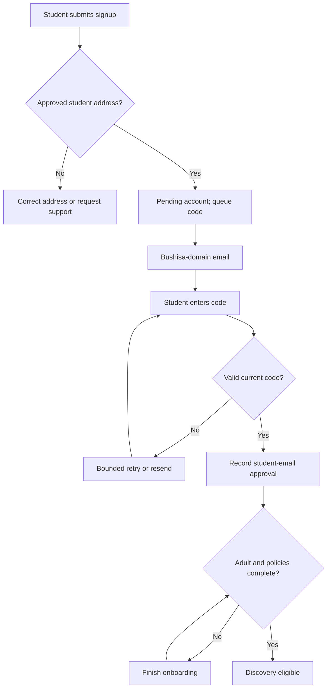

# Bushisa: P0–P2 remediation and Azure deployment prompt playbook

## Current decision authority: 2026-10-15

Use the current [decision register](remediation/decisions.md), its
[Q01-Q48 owner reconciliation](remediation/owner-policy-reconciliation-2026-10-15.md)
and [retention matrix](remediation/data-inventory-retention-matrix.md) before
executing these historical task prompts. D03 approves the full next-production-ready
feature scope, including geography, with existing Azure hosting; older narrow
pilot/feature-removal suggestions here are not an approved scope reduction.
Earlier provisional close-on-unmatch, unsent-placeholder, retention and geographic
defaults do not replace recorded approvals. Owner-selected policy is distinct
from implementation/evidence, qualified review and release acceptance.

Q08's renewed-consent undo requirement and Q45's Reply-To fallback remain pending
conflicts against earlier approvals. Explicit new proposals remain proposed.
Exact owner acceptance UTC/Harare timestamp is CONFIRM; no human review is
completed by this note. The [read-only impact checklist](remediation/configuration-impact-checklist-2026-10-15.md)
and [later bounded backlog](remediation/backlog.md#q01-q48-implementation-backlog)
do not authorize running deployment/configuration/migration examples now.

Prepared: **8 October 2026**, Africa/Harare.  
Updated: **9 October 2026**, Africa/Harare — geographic proximity alongside reciprocal matching; retains confession timestamp repair, student-email approval codes and a verified Bushisa-domain sender.  
Repository: [Takudzwa00kyle/Bushisa](https://github.com/Takudzwa00kyle/Bushisa).  
Source: the attached **Bushisa_Production_Feasibility_Study(2).md**.  
Source audit commit: **`ecf6217ceda74cc257d75483f253862b932dfe9d`**, branch `main`.  
Purpose: copy-ready prompts and acceptance gates for repairing the existing PHP/MySQL application and preparing it for **Microsoft Azure**. This document is a work plan; it does not claim that any repair, deployment or test has been completed.

## 1. Outcome and release boundaries

Preserve the existing PHP/MySQL application. Repair its identity, database, authorization and safety flows before introducing optional features. Use a small managed Azure deployment first; the feasibility study does not justify a framework rewrite, microservices or Kubernetes for approximately 5,000 registered students.

| Priority | Meaning from the feasibility study | Release boundary |
|---|---|---|
| **P0** | Blocks production use involving real users | Every P0 defect is repaired and verified; required operational and policy decisions are resolved. |
| **P1** | Required for the initial public launch, unless explicitly removed from its scope | Launch features work end to end; Azure recovery, monitoring and workload gates pass. |
| **P2** | Improvements after a successful controlled launch | Each enhancement has measured justification, its own tests and an independent release decision. |

P0–P2 are delivery priorities, not incident severity levels. Security, data loss or authorization failures discovered during P2 immediately become release blockers; they are not postponed because they were found later.

An out-of-scope feature must disappear from the active UI/API and product promises. Removing a feature from launch cannot waive adult eligibility, authorization, working block/report controls, deletion obligations or safe deployment. A narrow launch may omit confessions entirely, for example, but keeping confessions requires repairing its reporting and reference privacy.

The source study describes one historical commit. The first prompt must inspect the current checkout, compare it with that commit, and classify findings as reproduced, already repaired, changed or unresolved. Do not blindly reapply historical fixes.

**Additional integration finding U01:** the operator reports that posted confessions keep displaying **“now”**. The previous playbook covered UTC generally but had no confession timestamp repair or display acceptance contract. U01 is a user-reported regression, not a finding verified by the source audit. B00/B01 must reproduce and trace it; **P1-04T** defines the required repair. If confessions remain in launch scope, correct posting times are a P1 requirement and must not be deferred to P2.

**Additional requirement U02:** matchmaking must use geographic proximity alongside the existing reciprocal compatibility, mutual eligibility and other approved strategies. The previous workflow did not specify a geographic signal. This is not evidence that the current repository lacks one: B00 must inspect it, and **P1-01G** must verify/reuse working logic or integrate what is missing. Geographic ranking is required for P1; individual students may decline location use and retain ordinary matchmaking. Later P2 tuning does not substitute for this initial implementation.

## 2. How to use this playbook

1. Give the coding agent the repository checkout, this playbook, the source study and the approved decision register below.
2. Run **B00** and **B01** first. Use a task branch or isolated worktree; preserve unrelated work.
3. Paste the **shared execution contract** once per fresh agent session, then run one bounded task prompt at a time.
4. At the end of each task, review the diff, test evidence, migrations and outstanding engineer actions. Carry that handoff into the next session.
5. Execute Azure mutations only within the authority explicitly granted for the selected environment. This document authorizes planning, not spending money or deploying a live service.
6. Stop a dependent task when a required product decision is missing. Continue independent repair work. Never invent institutional rules, retention periods or claimed test results.
7. Reproduce release checks against the exact Azure-bound artifact and database version. Passing PHP syntax checks alone is not a completion criterion.

### Shared execution contract — paste before any task

```text
You are repairing Takudzwa00kyle/Bushisa using the attached production
feasibility study and this Azure P0–P2 playbook. Work on the current checkout.

Before editing:
- Read applicable repository instructions; report branch, HEAD, working-tree
  state and task dependencies. Preserve unrelated changes.
- Verify the finding against current code and actual active routes. Historical
  paths and observations are leads, not proof that current code is unchanged.
- Trace the form/API, shared service, SQL, authorization and rendered response.
- Identify schema changes, downstream consumers and approved policy inputs.

Implementation:
- Keep PHP/MySQL and the existing rendering model unless the task requires a
  documented change. Keep native PDO prepared statements enabled.
- Make the smallest coherent service-level repair; update every active caller.
- Use additive migrations. Do not reset a non-disposable database, overwrite
  real passwords, enable automatic verification, or put DDL in HTTP handlers.
- Use synthetic data. Do not copy student profiles, messages or photos into
  tests, prompts, logs, analytics or public artifacts.
- Do not commit secrets, publish profiles, storage keys or connection strings.
- Do not silently disable a security check to make a test pass.
- Implement mandatory student-email approval by entered code under section 4A;
  sending email or accepting a domain suffix must never approve an account.
- Preserve immutable, server-set confession posting times. Follow P1-04T for
  X-style display; never substitute the current time for missing/invalid data.
- Check and integrate geographic proximity under P1-01G alongside current
  reciprocal matching. Apply mutual hard eligibility first; proximity cannot
  override blocks, adult/verified state, preferences or discovery consent.
- Collect location only for an approved, explicit purpose. Keep raw device
  coordinates out of public responses, logs and Azure/Datadog telemetry.
- Separate application repair from external account, billing and policy work.
  Produce concrete commands/checklists for engineer actions that are pending.

Verification:
- Add focused regressions for repaired behavior, including relevant negative
  authorization cases. Exercise the real HTTP route where the defect is there.
- Run meaningful checks on the selected MySQL version, not only MariaDB.
- Concurrency tests must overlap independent DB transactions/connections.
- Record commands, runtime versions and outcomes. An unavailable environment
  means NOT RUN/BLOCKED, not PASS. Never mark a human gate complete yourself.

Return:
1. Finding IDs, changed files and resulting behavior.
2. Migration/configuration changes and deployment ordering.
3. Tests run and results, with any blocked checks.
4. Known limitations, rollback implications and engineer actions.
5. A concise handoff for the next task. Do not claim production readiness.
```

### Required handoff record

```text
Task ID:
Finding IDs:
Commit/artifact identifier:
Status: implemented / partial / blocked / verified
Changed files:
Migrations and configuration:
Checks: command | runtime | PASS/FAIL/NOT RUN | evidence path
Remaining policy decisions or external actions:
Rollback/data compatibility:
Next task and prerequisites:
Engineer reviewer and review date: pending until actually reviewed
```

## 3. Engineer decision register

Create `docs/remediation/decisions.md`. These are inputs to implementation, not values for the agent to invent. Record the owner, decision, date and reason. Until approved, development defaults may be used only in synthetic environments and must be labelled provisional.

| Decision | Required input | Why it matters |
|---|---|---|
| D01 — Campus membership | Approved institutional email domains; student-number grammar; enrolment proof and alumni/graduation policy | An email suffix or plausible number does not prove current membership. Normalize letters to lowercase; do not infer a complete regex from one example such as `n02531234f`. |
| D02 — Adult eligibility | Minimum age of at least 18 for this adult matchmaking release; birthday boundary and dispute/correction procedure | Prevent inconsistent age checks and unsupported identity claims. |
| D03 — Product scope | Which of discovery, chat, confessions, single/multiple photos and notification controls launch | Determines which P1 features must be completed and what must be removed. |
| D04 — Messaging and safety | Approval/re-request rules; block/unmatch consequences; unsend and retained-evidence visibility | Forms, APIs and moderation must follow one model. |
| D05 — Data lifecycle | Reviewed field-by-field retention, evidence holds, rights requests and backup expiry | Prevent hard-coded retention assumptions or misleading deletion promises. |
| D06 — Azure ownership | Operator, tenant/subscription, permitted offer use, region and approved budget | Hosting must have a legitimate continuing owner and funding path. |
| D07 — Availability/recovery | Acceptable downtime; recovery point objective (maximum data loss); recovery time objective (restoration time) | Determines whether one instance is acceptable or HA is required before launch. |
| D08 — Runtime/networking | Available supported PHP runtime; supported Azure MySQL version; private connectivity; session strategy | Local MariaDB diagnostic results are insufficient for Azure MySQL readiness. |
| D09 — Operations | Named engineering, moderation, support and privacy owners; escalation coverage | Alerts and reports require people able to act on them. |
| D10 — Telemetry | Approved fields, retention, alert recipients, Datadog entitlement and spending limits | Avoid logging private data or assuming all Datadog products are free. |
| D11 — Email approval delivery | Actual Bushisa-owned domain, approved From/Reply-To addresses, Azure Email resources/transport, code limits and membership assurance policy | Domain ownership, approved student addresses and real delivery need verification. Section 4A supplies implementation defaults; production sender values remain required. |
| D12 — Geographic matching | Approved campus/area catalogue and granularity; location-use consent; refresh/expiry and deletion policy; proximity weight/scale; distance disclosure; any explicit hard-radius behavior and optional Maps budget | P1-01G proposes a modest soft boost and coarse, optional location input. Approve production values and uncertainty handling; proximity is not student verification, an exact live position or a romantic-success probability. |

## 4. Azure target architecture and constraints

This is a recommended implementation baseline, not a pre-approved Azure purchase. Engineers must verify region, subscription quotas, current service capabilities and prices before provisioning.

| Component | Initial Azure choice | Required implementation |
|---|---|---|
| PHP web application | **Azure App Service on Linux**, built-in supported PHP runtime when compatible | Explicit Nginx public root, startup configuration, required extensions, HTTPS and protected paths. Use a custom container only if runtime/extension needs justify it. [A1] |
| Relational database | **Azure Database for MySQL Flexible Server**, General Purpose for production | Tested MySQL compatibility, TLS, private networking, separate runtime/migration users and additive migrations. Azure SQL is not a drop-in replacement. Current Microsoft guidance places Burstable in non-production scenarios. [A2] |
| Geographic ranking | Existing **PHP discovery service + MySQL**, approved coarse-area catalogue and optional browser location | Compute approximate distances locally; reuse reciprocal matching. No separate location server or paid map service is required by this baseline. Optional Azure Maps geocoding/maps require D12 approval, scoped authentication and metered-cost review. [A20–A23] |
| Network | App Service VNet integration, private database connectivity and DNS | Separate delegated subnets where required; verify outbound routes, DNS and job connectivity. VNet integration is outbound access, not private inbound access to the website. [A3] |
| Profile media | **Azure Blob Storage**, private containers | Object keys in the database; authenticated media authorization or narrowly scoped short-lived URLs; least-privilege data access. [A4] |
| Secrets | **Azure Key Vault** with App Service managed identity | Inject secrets into settings; keep runtime DB credentials separate from release credentials. Managed identity does not automatically authenticate PDO to MySQL. [A5] |
| Transactional email | **Azure Communication Services Email with a custom verified Bushisa sender domain** | Pending students receive codes at approved student addresses. Use a supported PHP transport, authenticated delivery and encrypted transactional outbox. Connect the verified email domain to the sending resource; see section 4A and [A12–A14]. |
| Scheduled work | **Azure Container Apps Jobs** running tested PHP CLI commands | Suitable for outbox delivery, retention and cleanup; approved container registry, private connectivity, timeout/retry policy and DB-backed leases. Cron schedules use UTC. [A6] |
| Sessions | Explicit persisted single-instance storage or a tested shared store | Keep sessions outside the public tree. Use shared sessions and distributed revocation/rate limiting before multiple app instances; do not assume local files work across workers. |
| Release | GitHub Actions CI and Azure deployment using **OpenID Connect** | Short-lived deployment authentication, narrow Azure RBAC, isolated staging, migration ordering and a release gate. [A7] |
| Observability | Azure platform metrics/logs; optional Datadog integration | Redacted application telemetry, error/latency/DB/email/job alerts and named responders. Monitor application outcomes as well as infrastructure health. |
| Recovery | Managed MySQL backups plus separate Blob/configuration recovery | Rehearsed restore, deletion tombstone replay, endpoint/credential cutover and measured recovery times. A MySQL restore creates a new server. [A8] |

### Important deployment choices

- **Basic-tier App Service has no deployment slots.** If using Basic, deploy staging as a separate application/environment and document maintenance-aware releases and artifact rollback. Choose a tier supporting slots if slot swaps are required; Microsoft lists Standard, Premium and Isolated for this capability. [A9]
- Staging must use separate database, media, secrets and safe email recipients. A slot is not automatic data isolation and consumes capacity in its plan. During swaps, account for target configuration being applied during warm-up; warm-up endpoints must not send mail, run migrations or modify user data. [A9]
- App Service supports VNet integration on dedicated tiers including Basic. Verify the selected SKU and regional configuration rather than assuming Free supports the architecture. [A3]
- A public GitHub runner cannot be assumed to reach a private MySQL server. Run release migrations from a trusted private-network job or approved runner. Do not expose MySQL publicly just to make deployment succeed.
- Configure App Service health checks against a bounded readiness route returning a real status, without login redirects or sensitive diagnostics. Health checks do not create redundancy for a one-instance app. [A10]
- Container Apps Job scheduling is separate infrastructure from App Service. Include its environment, registry, image, identity and cost in the plan; do not place cron inside a web request or assume the web process will reliably schedule work.
- Store timestamps and schedules in UTC. Select display timezones explicitly: use Africa/Harare for campus/business schedules; confession posting times follow the viewer-timezone contract in P1-04T.
- Do not build availability around pooled student accounts or repeated credit replacement. The 18+ Azure student offer has limited credit/free allowances and educational-use conditions; establish a permitted paid production path. [A11]

### Proposed configuration contract

These names are proposed. B00 must map existing names and retain compatibility deliberately; the agent must not invent settings that the application never reads.

| Group | Proposed keys / specification | Validation |
|---|---|---|
| Application | `APP_ENV`, `APP_DEBUG`, `APP_BASE_URL`, explicit trusted proxy rules | Production debug off; approved HTTPS URL; no unrestricted forwarded-header trust. |
| Database | `DB_HOST`, `DB_PORT`, `DB_NAME`, `DB_USER`, `DB_PASSWORD`, verified CA/TLS settings | No root/empty-password fallback; selected MySQL version and collation tested; runtime has no DDL. |
| Sessions | Store/connection or protected save path; lifetime and cookie settings | Secure/HttpOnly/SameSite as appropriate; all-session revocation; persistence and locking tested. |
| Storage | Account/container identification and auth mode | Identity-based Blob data access or reviewed temporary credential method; public access disabled. |
| Email | `MAIL_PROVIDER`, `MAIL_FROM_ADDRESS`, `MAIL_FROM_NAME`, `MAIL_REPLY_TO`, approved ACS endpoint/auth settings and `STUDENT_EMAIL_DOMAIN_ALLOWLIST` | Actual verified Bushisa From domain, exact approved student domains and restricted staging recipients; no credentials in templates. |
| Signup codes | `SIGNUP_CODE_LENGTH`, `SIGNUP_CODE_TTL_SECONDS`, `SIGNUP_CODE_MAX_ATTEMPTS`, resend/shared-window limits and `SIGNUP_CODE_HMAC_KEY` with version | Default six digits, 600-second expiry, five attempts/challenge and atomic shared limits. Key material remains outside the DB in the approved secret store. |
| Geographic matching | `GEO_MATCHING_ENABLED`, `GEO_WEIGHT`, `GEO_DISTANCE_SCALE_KM`, `GEO_LOCATION_TTL_SECONDS`, granularity/catalogue version and location-change limits | Proposed development defaults: enabled, 0.10 bonus cap, 10 km decay scale, 86,400-second device-location freshness and approximately 1 km coarse cells. D12 approves production values; unsupported or invalid configuration must not produce false “nearby” results. |
| Limits/jobs | Request/upload limits, recovery-token lifetime, throttle windows, retention policy reference | Shared by forms/APIs/jobs; explicit values approved; invalid required settings fail startup safely. |
| Telemetry | Environment, release ID, redaction/sampling and destination | No passwords, tokens, message bodies, questionnaire answers, precise DOB, raw student IDs, device coordinates, coarse cell identifiers or location request bodies. |

## 4A. Mandatory student-email approval-code workflow

**User requirement:** a signing-up student must receive a Bushisa approval code at the student email they supplied, enter it on Bushisa and pass server-side verification before the platform approves the account. This is a P0 requirement and is not replaced by a verification-link-only flow.

The recipient is the student's institutional mailbox. The sender is a separately verified Bushisa-owned domain, for example `verification@<BUSHISA_DOMAIN>`. This is a placeholder, not a claim that any particular Bushisa domain is owned or configured. The visible display name alone is insufficient; do not spoof a From address, use a personal mailbox or ship the default Azure domain as the production Bushisa sender.

### Student journey and access states

1. Student enters their student number, institutional email and signup credentials. Validate the **exact parsed email domain** against the approved student-mail allowlist and approved number rules. Never use loose suffix/substring matching; reject lookalikes such as `<approved-domain>.attacker.example`. Define institution-approved address normalization/uniqueness; do not arbitrarily remove dots or `+` suffixes.
2. Create a pending account/signup context and challenge, then enqueue a code email transactionally. Account approval remains false. Give only limited onboarding access; no discovery visibility, swiping, messaging, confessions or moderator privileges.
3. Send from the verified Bushisa address to the exact pending student address. The protected signup UI shows the destination, code-entry field, expiry guidance, resend countdown and email-correction option. It must not say “delivered” when mail is only queued or accepted by the provider.
4. Student enters the code through an HTTPS, CSRF-protected submission. Check challenge binding, purpose, current pending email, state, expiry and attempt budget entirely server-side. Never accept a client setting `is_verified` or student approval.
5. On success, atomically consume the challenge, record `email_verified_at`, institutional domain and verification method, and apply D01. This may approve the account as **student-email verified** if the approved membership policy accepts that proof. Preserve any additional membership-review requirement.
6. Continue/complete adult DOB and required policy acknowledgments. Full discovery eligibility requires student approval, adult eligibility, acknowledgments and a current unsuspended/undeleted account. Rotate the signup session on the privilege transition; email approval cannot bypass these checks.

The code proves access to the approved student mailbox. It does not independently prove current enrolment, identity, student-number ownership or age. UI labels and stored evidence must reflect that distinction. Where alumni/staff retain university mailboxes, D01 must define who qualifies; do not treat all university-domain accounts as current students.



### Approval-code contract and implementation defaults

These are proposed security/product defaults, informed by general secure-code practices [A15], not Azure restrictions. D11 may approve a documented alternative without weakening mandatory verification or brute-force protection.

| Concern | Required behavior |
|---|---|
| Code | Six decimal digits from a cryptographically secure generator; preserve leading zeroes as a string. Never derive from student number, time or counters. |
| Lifetime | Ten minutes from issuance, with server-side UTC expiry. Retry never extends it. Discard an expired queued email rather than sending a stale code as fresh. |
| Binding | Account/pending signup, normalized pending student email, signup-only purpose, opaque high-entropy challenge/context and current generation. One signup/recovery code cannot approve another. |
| Verifier storage | Keyed HMAC bound to challenge/account/email/purpose; key/version outside the DB and safe comparison. Plain unsalted hashing of six digits is insufficient against offline enumeration. No reusable raw code in challenge rows, API responses, sessions, logs or browser storage. |
| Mail payload | Encrypt code-bearing outbox payloads, restrict worker access and erase after send/expiry. Only the intended recipient receives the code; no CC/BCC or admin copy. Include provider processing in the reviewed data flow. |
| Attempts | Five incorrect attempts per challenge, incremented atomically; also a shared account/email/signup failure budget, initially ten failures per 15 minutes across generations. Resend cannot reset the brute-force budget. Exhaust the challenge rather than permanently locking an active account. |
| Resend | Initially a 60-second cooldown and five issuances/hour per account/email including the first. New code atomically supersedes the old challenge; cancel obsolete queued mail. Only the latest code works. Do not send on every page load. |
| Additional throttles | Campus-aware IP/global controls, shared across instances where needed. Resend/verify needs the limited signup context or authenticated pending account, not an arbitrary email supplied by an unauthenticated caller. |
| Concurrency | One current generation and single consumption in a transaction. Parallel correct submissions cannot double-approve or duplicate accounts/side effects; resend/address correction versus verification must check locked current state. |
| Failure/replay | Wrong, expired, exhausted, superseded, cross-account, changed-address and consumed codes never approve. Provider send success or a delivery callback never verifies the account. |
| Email correction/change | Validate the new institutional address, invalidate old challenges, clear approval as appropriate and issue a fresh code. Changing a verified institutional email requires recent authentication and re-verification; remove relevant session eligibility until complete. |
| Pending-account safety | An attacker reserving an email must not permanently exclude its owner or make the owner inherit an attacker-chosen password/profile. Finalize within a bound signup context; provide reviewed restart/recovery and expiry/cleanup of abandoned registrations. |
| UX | Accessible single code field, numeric input hints, `autocomplete="one-time-code"`, paste and leading-zero support. Clear invalid/expired/cooldown feedback, safe email correction and support help; do not expose account existence publicly. |
| Separation | Signup approval is separate from password-reset tokens, moderator approval and future two-factor authentication. Maintain independent purpose, authority and state. |

### Data and endpoint contract to generate during P0-04

Use additive migrations. Proposed challenge fields: opaque ID, account/signup reference, pending-email reference, purpose, generation, keyed verifier/key version, issue/expiry/consumed/superseded timestamps and attempt state. Keep shared failure/issuance windows independent of each challenge. Store encrypted outbox reference and safe send/provider status where needed; no public provider operation IDs.

Document actual signup, code verification, resend and email-correction routes: method, limited-session authentication, CSRF, inputs/outputs and throttle behavior. Mutations use POST and the repository's real routing conventions. A code-free “open verification page” link may help navigation, but GET, email scanning and opening it never approve. Password recovery may retain its own reviewed link flow.

### Azure sender and delivery workflow

The engineer configures a custom Bushisa domain in **Azure Email Communication Services**, verifies domain ownership and SPF/DKIM, sets the permitted sender username and connects the domain to the **Azure Communication Services** sending resource. Use records generated for the actual domain, review existing SPF before editing, and have the domain/mail owner configure aligned DMARC and check received headers. [A12–A13]

Choose a supported PHP transport: a reviewed REST adapter or SMTP library/relay supported by ACS. Verify current authentication, permissions, versions and response semantics. Do not invent an official PHP Email SDK or assume managed identity works with every SMTP adapter. Keep credentials in Key Vault; any identity-based HTTP path must be supported and tested. [A14]

Dispatch the transactional outbox promptly, with bounded retry/backoff, expiry/current-generation checks and queue/failure alerts. Worker cadence must fit the ten-minute window. Provider acceptance differs from delivery; verify inbox/spam/bounce outcomes with approved test mailboxes. During sender/provider outages keep accounts pending and offer safe resend/support guidance. Fake mail is for tests; production has no fixed-code or automatic-approval fallback.

### Additional mandatory acceptance cases

- Real student test mailbox receives the code from the verified Bushisa From address; received headers confirm configured sender authentication.
- Pending users cannot discover/be discovered, swipe, chat, post or gain privileges before approval and remaining onboarding.
- Correct current code succeeds once; leading-zero codes work; proof is recorded without raw-code storage.
- Wrong, expired, replayed, superseded, cross-account and wrong-purpose codes fail. Parallel attempts/resends cannot bypass budgets or double-approve.
- Issuance and failures are bounded across generations; obsolete queued mail never revalidates an old code.
- Disallowed/lookalike domains, duplicates, address correction, lost context and email pre-reservation have safe tested outcomes.
- Sender misconfiguration, timeout, bounce, delayed/expired mail never approves users or leaks codes in diagnostics.
- Legacy automatically verified accounts follow the approved re-verification rollout; old signup-link handlers cannot bypass code entry.


## 5. Finding-to-task traceability

| Finding/source | Required task(s) | Completion evidence |
|---|---|---|
| F01 — Verification/adult onboarding | P0-04; P0-08 | Bushisa-domain code delivery and entry; rejection/concurrency cases; adult eligibility and accurate proof labels. |
| F02 — Native PDO/database failures | P0-02; P1-02 | Azure-bound MySQL integration suite; successful match/chat/block/deletion; concurrency outcomes. |
| F03 — Conflicting schemas/runtime DDL | P0-01 | Clean install and legacy upgrades; canonical roles; restricted runtime SQL account. |
| F04 — Stale session authorization | P0-05 | Two simultaneous sessions lose privileges/access after relevant account events. |
| F05 — Safety and reference privacy | P0-06 | Atomic block/report operations, private target resolution, safe public DTOs. |
| F06 — Deletion/retention mismatch | P0-07; P1-07 | Lifecycle inventory, deletion/cleanup retry tests, restore with tombstone replay. |
| F07 — Unsafe release/CI | P0-03; P0-08; P1-07 | Tested public root, CI, Azure infrastructure/release plan and actual staging recovery rehearsal. |
| F08 — Discovery cap/pagination | P1-01; P1-06 | Late eligible profile reachable, stable pages, version-safe scoring, query/load evidence. |
| F09 — Match/request races | P1-02 | Overlapping connections, retries, state transitions and block/revoke races. |
| F10 — Media quota/storage | P1-03 | Durable Blob integration, resource-bounded processing, quota/cleanup and failure recovery. |
| F11 — UI/API mismatch | P1-04; P1-04T | Active browser flows, consistent contracts, usable safety controls and honest feature scope. |
| F12 — Recovery/abuse/operations | P1-05; P1-06; P1-07 | Secure recovery, campus-aware throttles, bounded histories, job and alert ownership. |
| U01 — User-reported confession time stuck at “now”; supplements F11 | B00/B01; P1-04T | Original DB time survives reload/edit; canonical API timestamp; advancing X-style labels, exact-time access and timezone/boundary regressions. |
| U02 — Required geographic proximity alongside reciprocal matching | B00/B01; P1-01G; P1-04; P1-06 | Current-code audit, consent/coarse-location flow, combined-ranking fixtures, fallback/privacy/deletion tests, stable pages and Azure load/device evidence. |

### Dependency order

Run B00 → B01 → P0-01 → P0-02 → P0-03. Implement P0-04 and P0-05 before final safety/lifecycle integration. Then complete P0-06 → P0-07 and integrate P0-08 with all affected services. P0-08 infrastructure/email contracts can be prepared after P0-03 while P0-04 is implemented with fake mail locally. Actual sender setup and code delivery must integrate before P0 clearance; this avoids a circular dependency on a live provider during coding.

After the P0 gate: implement P1-01 → P1-01G → P1-02 → P1-03 → P1-04 → P1-04T → P1-05 → P1-06 → P1-07 → P1-08. Geographic schema/consent contracts and timestamp schema/serialization work may be prepared alongside earlier repairs; finish geographic ranking and all active confession views before P1-08. Shared schema/auth dependencies can change the local order, but never certify a downstream gate with blocked prerequisites. P2 begins after launch evidence supports it.

## 6. Baseline prompts

### B00 — Reconcile the audit with the current repository

```text
Inspect the current Bushisa checkout against the attached study, whose audit
commit is ecf6217ceda74cc257d75483f253862b932dfe9d. This task is read-only
except for adding remediation planning records.

Record current HEAD, working-tree state, available PHP/MySQL/Node tooling,
active pages/API routes, both SQL schemas, runtime DDL and deployment assets.
For each F01–F12, show the current relevant files and classify the finding:
reproduced / already repaired with evidence / changed / not yet verified.
Separate current source facts from historical local test results.

Also inspect user-reported U01: confession times remain "now". Map the current
insert/update SQL, stored posting-time column, API fields, server-rendered markup,
loaded formatter and refresh behavior. Identify whether the fault is storage,
serialization, parsing, timezone/clock handling or a stale label; do not assume
the cause. Classify U01 separately from the historical F01–F12 findings.

For U02, inspect current discovery/matching services, schemas, onboarding,
preferences, location permissions and loaded UI. Search for campus/area IDs,
latitude/longitude, geohash/spatial fields, distance calculations and proximity
weights/radii; distinguish active behavior from unused code or text labels.
Trace how the existing reciprocal score, questionnaire/intention/preferences,
exposure/rotation and cursors work. Classify geographic support as absent,
partial or implemented with evidence. Reuse validated logic rather than adding
a parallel matcher; document missing contracts and P1-01G work.

Map existing environment keys and every writable/runtime directory. Inventory
all personal-data tables and media references. Identify orphan-prone foreign
keys and cascading deletion behavior. Compare current configuration with the
Azure baseline; preserve existing useful code and working features.

Create docs/remediation/backlog.md and decisions.md, with task dependencies,
the D01–D12 decisions, U01/U02, risks and a proposed narrow launch scope. Do not mark a
finding resolved on source inspection alone if it requires execution proof.
Return the baseline report and proposed first implementation task.
```

**Done when:** every study finding and U01/U02 has a current status, evidence lead, task and owner; missing inputs are explicit. No repository repair is falsely claimed.

### B01 — Establish reproducible failing regressions

```text
Build a small regression harness for Bushisa using disposable synthetic data,
native PDO prepares and the MySQL version proposed for Azure. Include HTTP
cookie/CSRF handling and at least two independent database connections.

Reproduce the current failures identified by B00: automatic verification,
missing student-email approval-code flow, missing DOB journey, future-DOB scoring,
reciprocal likes, matches/chat,
partial blocking, stale suspended sessions, deletion, anonymous reporting,
flagged references, cursor repetition and an eligible candidate after 500
ineligible accounts. Adapt cases to current routes; do not fabricate results.

For U01, preserve a confession's saved time and capture DB/API/rendered evidence.
Use an injected/fake clock to advance age without waiting in real time. Assert
that an older valid confession is not labelled "now" and that reloading or
reacting/editing does not reset its posting time. Retain the P1-04T boundary,
invalid-date and timezone cases as regressions; do not hardcode the expected
label into the active page to satisfy the test.

For U02, add synthetic pairs with equal compatibility but different coarse
locations, a nearby ineligible/blocked profile, a far stronger reciprocal match,
missing/stale/declined location and differing mutual distance preferences if
supported. Capture present ranking behavior before repair; use P1-01G's expected
contract after integration. Include private-field, withdrawal/deletion and
location-change/cursor regressions, without using real student coordinates.

Create normal, unverified, paused, underage, suspended, deleted, moderator and
unrelated synthetic identities. Test public/private response fields.
Give every test isolation and deterministic cleanup. Reset/seed commands must
reject production and any database not explicitly identified as disposable.

Record known failures in the baseline, but do not permanently skip them or
configure release CI to succeed while regressions remain. New repair tasks
must turn their corresponding failures into passing assertions. Provide a
documented local test command and machine-readable results.
```

**Done when:** defects can be reproduced without real user data; fixtures and expected outcomes are documented; blocked execution is labelled.

## 7. P0 prompts — repair release blockers

### P0-01 — Canonical schema, additive migrations and roles

**Finding:** F03. **Dependencies:** B00/B01. **Engineer inputs:** D04/D05 and legacy-data availability.

```text
Replace competing schema assumptions and request-time schema creation with one
canonical MySQL schema plus numbered additive migrations and history tracking.
Inspect database/bushisa.sql, sql/schema.sql and php/operational.php.

Support the approved fresh-install and legacy variants explicitly. If data is
ambiguous, report the reconciliation decision rather than silently dropping it.
Include pending/verified email state, code challenges, shared budgets and the
encrypted email outbox from section 4A in the additive schema plan.
Inventory confession posting-time fields for U01/P1-04T. Preserve original
instants; flag unknown legacy values and timezone provenance for reconciliation.
Do not backfill historical posting times with migration execution time.
Plan U02's private coarse-location/consent/version fields or existing equivalents,
with nullable absence, approved freshness and lifecycle behavior. Preserve any
valid existing location data only within its approved purpose; do not infer
student locations from IP addresses or fabricate coordinates during migration.
Migrate roles, account state and operational relationships without overwriting
passwords, verification, suspension or existing messages. Reconcile orphaned
rows before adding foreign keys; preserve approved report evidence.

Remove CREATE/ALTER/DROP and schema bootstrap calls from HTTP execution.
Separate runtime DML privileges from migration privileges. Provide secure,
auditable CLI moderator provisioning; ordinary registration cannot assign a
privileged role. Guard reset/seed tools against non-disposable databases.

MySQL DDL can commit implicitly: do not claim wrapping all migrations in a
transaction guarantees rollback. Use rehearsed backups, resumable steps,
checksums/history, and an expand/contract compatibility plan.

Test clean install, upgrade of representative old data, rerun/interrupted
migration recovery, runtime operation with restricted privileges, moderator
provisioning and rejection of ordinary-user admin access.
```

**Gate:** schema/upgrade tests pass; users/messages survive; runtime requests work without DDL privileges; approved moderator provisioning works.

### P0-02 — Repair native PDO and database compatibility

**Finding:** F02. **Dependencies:** P0-01.

```text
Repair reused named SQL markers and database metadata probes while keeping
PDO::ATTR_EMULATE_PREPARES=false. Trace current versions of api/swipe.php,
api/matches.php, api/messages.php, chat.php, api/safety.php, anonymiser and
moderation helpers, plus every matching SQL template in the repository.

Give each placeholder occurrence a unique name or use positional parameters
with exact binding counts. Replace incompatible parameterized SHOW probes
with proven information_schema queries where metadata is still necessary.
Do not retain request-time schema discovery to hide missing migrations.

Run matching, request/approve/revoke, send/read/unsend, blocking, admin and
deletion regressions against the selected MySQL version. Exercise both API
and server-form callers. Unrelated users must get authorization errors, not
data or raw SQL diagnostics. Add fault tests for transaction rollback where
one action updates more than one table.

Return all repaired templates and actual integration results. Do not claim
this task resolves simultaneous-like races; P1-02 verifies that separately.
```

**Gate:** normal matching, chat, safety and deletion query paths execute successfully under native prepares; negative access cases remain blocked.

### P0-03 — Safe web root, environment validation and real CI

**Finding:** F07. **Dependencies:** P0-01/P0-02.

```text
Make the PHP release reproducible and safe for Azure App Service Linux.
Select a supported available runtime and verify pdo_mysql, fileinfo, mbstring
and the required image extension. Introduce a dependency manifest/lockfile
only for actual dependencies; pin build inputs and document their purpose.

Make public/ a complete entry-point/asset tree OR provide a strict server
allowlist with equivalent evidence. Preserve route URLs deliberately and
update includes/asset references. Nginx does not enforce Apache .htaccess;
implement and test the actual Linux server configuration and persistence.
Internal helpers, config, SQL, docs, logs and repository metadata must not be
web-accessible. Disable listing and executable uploads.

Align real environment names, loading and DB_NAME. Remove production root or
empty-password defaults. Fail safely on missing required production settings;
return generic errors and log redacted diagnostics. Configure TLS/proxy trust,
cookie security, request limits and writable paths explicitly.

Replace placeholder CI with checkout, PHP/JS lint, disposable MySQL migration
and regression checks, and applicable dependency/secret checks. PR checks
must not receive production credentials or deploy permissions. A deliberately
broken meaningful assertion must make CI fail.
```

**Gate:** clean build works; private-path HTTP probes return 403/404; missing secrets fail safely; meaningful CI failure blocks release. Passing this task does not waive remaining P0 failures.

### P0-04 — Student-email approval codes, adult onboarding and policy records

**Finding:** F01. **Dependencies:** P0-01/P0-02/P0-03 and integration with P0-08 email contracts. **Engineer inputs:** D01/D02/D11 and approved policy text. Use fake mail locally first; actual sender verification is required before real-user release.

```text
Implement the mandatory signup approval-code architecture in section 4A.
New students receive a code at the exact approved student email they entered,
from the verified Bushisa-domain sender, and enter it on Bushisa. Registration,
mail dispatch and link opening never approve an account automatically.

Build shared form/API signup, verify, resend and email-correction services,
limited signup context, CSRF and exact-domain allowlisting. Normalize student
number letters and enforce the approved D01 grammar. Keep mailbox verification,
membership approval, adult eligibility and policy records separate; all required
checks must pass for discovery. Email access alone does not prove current
membership, identity, number ownership or age.

Use the section 4A defaults: six-digit CSPRNG strings, ten-minute expiry,
challenge-bound keyed HMAC with external key, five failures per challenge plus
a shared failure budget, 60-second resend cooldown and bounded issuances.
Add migrations, encrypted short-lived outbox payloads, generation/expiry checks,
atomic consume/resend, context binding and safe pending-account restart.
Do not return codes in JSON or put them in logs, sessions, URLs or browser storage.

Use the P0-08 ACS provider interface/transport. Fake mail is for synthetic tests
only. Retire any legacy signup link that bypasses entered-code approval; a
code-free navigation link can only open the form. Keep password-reset purpose
and authorization independent. Document route, field and state contracts.

Reuse one strict DOB/age validator across writes and scoring. Reject impossible,
future and underage dates; test exactly-18/leap-date/legacy-NULL boundaries.
Keep full DOB private. Record required policy versions/timestamps and separate
optional opt-ins. Pending users have only approved onboarding access.

Test actual code-entry UI, leading zeroes, invalid/expired/replayed/superseded
and wrong-purpose codes; parallel verify/resend/email changes; attempt budgets
across resends; lookalike domains; delayed/failed mail; lost signup context;
email pre-reservation; missing acknowledgments and incomplete onboarding.
Add paste/countdown/error/correction states and server-enforced restrictions.
Existing unproven verified accounts need an engineer-reviewed re-verification
rollout; never silently trust or indefinitely block them.
```

**Gate:** section 4A and real code-entry tests pass; pending accounts stay restricted; an approved adult completes onboarding; engineer verifies actual Bushisa sender configuration and student-inbox delivery before real-user release.

### P0-05 — Current authorization and all-session revocation

**Finding:** F04. **Dependencies:** schema and onboarding integration.

```text
Replace session-user-ID-only guards with one current account authorization
service. Check account state, onboarding eligibility where required, current
role and session version on every protected form/API action. Record an access
matrix; distinguish allowed onboarding routes from discovery/chat/admin.

Add absolute/inactivity lifetimes, login/session-ID rotation, CSRF protections
and recent authentication for sensitive actions. Suspension, deletion and
password reset/change must invalidate all existing sessions. Privilege removal
must take effect immediately; privileged role assignment must require fresh
authorization and must not inherit stale elevated state.

APIs return consistent JSON 401/403; pages may redirect safely. Do not trust
cached session roles or accept user IDs supplied by a client as authorization.
Implement persisted single-instance sessions explicitly. Record the shared-
store requirement before scale-out and do not call sticky routing revocation.

Test two live sessions per account, suspension during a session, role removal,
deletion, expired session/CSRF, reset/change events and unrelated-user access.
Exercise an already authenticated confession or message write after suspension.
Also test pending-code accounts and loss of eligibility after a verified email
change; never let a cached verified flag bypass the current approval state.
```

**Gate:** old sessions cannot mutate after revocation events; role removal stops admin access; page/API behavior is consistent.

### P0-06 — Atomic safety controls and privacy-safe responses

**Finding:** F05. **Dependencies:** P0-02/P0-05. **Engineer input:** D04/D05.

```text
Route block/unblock, report, unmatch and moderation actions through shared
services used by both server forms and APIs. Define transitions from the
approved D04 policy, with transactional consistency, idempotent retries and
authorization at the time of mutation.

Blocking must immediately prevent discovery/contact and revoke chat access.
If subsequent updates fail, roll back the whole operation. Resolve report
targets and hidden authors on the server using authorized records. Anonymous
reporters must never receive the hidden author's identity. Separate ordinary
reports from moderator-only hide/flag actions; rate-limit abusive submissions.

Suppress flagged/deleted content from feeds, references, previews and other
public projections. Replace missing references with a safe neutral state.
Use explicit public DTO field allowlists: age where needed, not full DOB,
student number, email, raw answers, internal scores or moderation identities.
Keep location coordinates, coarse cell IDs, exact pairwise distances and
geographic ranking components out of public DTOs, HTML and signed cursors.
Only approved coarse area/band explanations may be shown under P1-01G/D12.
Preserve approved restricted case evidence before any cascade deletes it.

Test anonymous reports, forged targets, cross-user actions, public reference
leaks, moderator authorization, duplicated actions and injected mid-operation
failure. Return a coverage matrix for discovery, chat and confessions.
```

**Gate:** complete block/report journey works; rollback leaves consistent state; hidden authors and suppressed content remain private.

### P0-07 — Deletion, retention, rights handling and reliable cleanup

**Finding:** F06. **Dependencies:** P0-01/P0-02/P0-05/P0-06. **Engineer input:** D05.

```text
Inventory every personal-data table, object, cache, session, log and backup
category. Implement the approved erase/anonymize/retain-with-expiry decision
for each; do not assume clearing a password means complete deletion.

Deletion must require recent authentication/password confirmation as approved,
set an explicit deleted state, revoke every session and remove discovery/contact
access immediately. Define visible conversation/reference behavior and restrict
retained evidence to authorized case handlers. Include questionnaire answers,
DOB, demographic details and operational/exposure records in the inventory.

Use a transactional outbox for external media cleanup after DB commit. Add
idempotent CLI jobs, bounded batches, retry/backoff, leases and failure status.
Never delete a file before a transaction that could roll back. Retain a
minimized deletion ledger usable after restoring an older backup; replay it
before reopening the restored service so deleted accounts/data do not return.

Provide authenticated access/export/correction request handling with ownership
checks and auditable completion, whether initially assisted or fully automated.
Align privacy text with actual behavior and expiry; flag decisions for review.
Test deletion through UI/API, all-session revocation, partial cleanup failure,
retry, legal-hold rules where approved and a synthetic old-backup restore.
```

**Gate:** deletion works and has a field-level lifecycle; retry restores consistency; deletion ledger survives and is replayable independently of the restored old database. Never claim immediate removal from immutable backups.

### P0-08 — Azure infrastructure and deployment foundation

**Finding:** F07 and storage/job dependencies. **Dependencies:** P0-03 and service contracts.

```text
Create an Azure infrastructure plan and Bicep modules for the approved target.
Separate staging/production parameters and include App Service Linux, MySQL
Flexible Server, VNet/subnets/private DNS, Blob, Key Vault, managed identities,
observability and scheduled PHP job infrastructure with registry access. Include
Azure Email Communication Services, custom Bushisa domain/sender resources,
the connection to Azure Communication Services and transport permissions/settings.
Keep credentials out of code, outputs, deployment parameters and logs.

Use private DB connectivity and verified TLS, runtime DML credentials and a
separate migration identity/credential. Document how Blob identity authentication
works from the selected PHP library or REST adapter; do not invent SDK methods.
Grant scoped Blob data and Key Vault roles. Verify job access to private services.

Define health/readiness routes with bounded checks and no secret output. Provide
startup validation, protected session persistence, media durability and a CLI
job image built from the relevant pinned code. Only authenticated private jobs
may perform privileged tasks; do not expose migration/retention web endpoints.

Create CI/CD authentication using GitHub OIDC with restricted environment
subjects and scoped Azure RBAC. Choose Basic plus a separate staging app, or
a supported slot tier, explicitly. Do not claim Basic provides slots.
Produce a resource/cost inventory, build/validation commands, deployment
what-if instructions, private-network migration plan and a rollback draft.
Document D11 sender/DNS checks, supported PHP REST or SMTP delivery, encrypted
outbox dispatch within code TTL, delivery diagnostics and expiry/failure alerts.
Leave actual domain ownership/authentication sign-off to the engineer.
Provision staging only if that environment is authorized; production remains
subject to the release gate. Mark live checks pending when access is absent.
```

**Gate:** templates/builds validate; secrets and environment separation are explicit; engineer verifies an actual staging deployment, DB connectivity, private paths, jobs and identities before P0 certification.

### P0 exit checklist

- [ ] F01–F07 are repaired in the current code or the affected optional feature is fully removed with reviewed scope.
- [ ] Clean install and representative upgrades pass on the Azure-bound MySQL version.
- [ ] Native SQL regressions pass; runtime DDL and privileged defaults are absent.
- [ ] Real onboarding, current authorization, safety and deletion flows pass.
- [ ] Student-email approval codes are mandatory, purpose-bound, expiring and single-use; retry/resend limits and pending-account restrictions pass.
- [ ] Bushisa-domain sender authentication and actual student-mail delivery are verified; sending or opening an email cannot approve an account.
- [ ] No unintended private fields, suppressed references or public internal files are returned.
- [ ] Required Azure staging foundation, private connectivity, persistent state and safe configuration are verified.
- [ ] Engineer/product/privacy decisions needed for safe real-user use are resolved.
- [ ] The engineer reviews evidence; unresolved blockers cannot be labelled “accepted risk” to pass this gate.

P0 clearance permits progression to the P1 launch gate. It does not authorize public launch by itself.

## 8. P1 prompts — complete the controlled public launch

### P1-01 — Complete eligible retrieval and stable discovery pages

**Finding:** F08. **Dependencies:** P0 authorization/onboarding/schema. **Engineer inputs:** launch discovery scope and questionnaire interpretation.

```text
Repair the discovery service and API so eligible later accounts are reachable
and page cursors work despite intervening swipes. Inspect php/matching/service.php
and api/discover.php. Do not merely increase the historical 500-row limit.

Apply reciprocal hard eligibility, active/verified/adult state, discovery opt-in,
pause, blocks and prior decisions before ranking where practical. Add approved
discoverability/activity fields. Use a stable keyset or expiring snapshot cursor;
bind it to the requester and query/version, validate tampering and document
refresh/expiry semantics. Determine has_more from eligible retrieval, not a
truncated ineligible prefix. Remove offset defaults that override cursors.

Page through a bounded pool without scanning all questionnaire data per request.
Validate catalog versions, matrices, unknown/legacy answers and needs_review on
reads/scoring as well as writes. Keep scores labelled heuristic compatibility,
not a probability of romantic success. Preserve reciprocal hard constraints.

Add minimal exposure records and a reviewed rotation/variety rule that prevents
permanent low-ID preference without collecting unnecessary private data.
Test 5,000 synthetic profiles, an eligible profile after 500 ineligible ones,
swipes between requests, paused/blocked accounts, stale cursors, empty pools,
unknown answers and accurate public DTOs. Measure relevant queries.
```

**Gate:** distinct stable pages; eligible late accounts reachable; no unauthorized candidate returned; scoring excludes invalid questionnaire evidence.

### P1-01G — Check and integrate geographic proximity with reciprocal matching

**Requirement:** U02, related to F08/F11/F12. **Dependencies:** P1-01 and P0 schema, identity, authorization, privacy and lifecycle services. **Engineer inputs:** D12, with D05/D10 for lifecycle/telemetry. **Priority:** required P1 functionality; dropping it requires an explicit operator-approved change to the user's requested scope.

#### Check the existing implementation first

Follow B00's route/service/schema/UI trace. Produce `docs/remediation/geographic-matching.md` with current active fields, location source/consent, distance units, score composition, filtering, pagination and privacy behavior. Mark each requirement **implemented and verified / partial / absent / not yet verified**. A `location` text column or unused latitude field is not proof that matching uses geography. Where active geographic logic passes the contract below, preserve it and add only missing integration/evidence. Otherwise implement it in the existing authoritative discovery service, not a separate recommendation API.

#### Location collection and privacy contract

| Situation | Required behavior |
|---|---|
| Student chooses a campus/general area | Resolve an approved catalogue ID to a coarse representative point on the server. Describe suggestions as based on the selected area; do not present it as a verified current position. Catalogue points/labels require H13 review. |
| Student explicitly chooses “Use my approximate location” | Explain the matchmaking purpose, then request a one-off browser position over HTTPS with permission. Bound timeout/cached age; validate accuracy and age. Browser permission alone is not application consent to store/use location. [A20] |
| Permission denied, unsupported browser, timeout, unavailable or poor-quality fix | Offer manual area selection or ordinary reciprocal discovery. Do not repeatedly prompt, infer location from IP/student number, or block signup/email approval. |
| Student chooses no location or withdraws location use | Keep ordinary matchmaking. Remove/stop using the location signal, clear derived caches and prevent future acquisition until a new explicit choice. Withdrawal is separate from leaving discovery entirely. |
| Device-derived location becomes stale | Treat it as unavailable for proximity until explicitly refreshed; an independently chosen manual area may remain usable under its disclosed policy. Never label an expired fix as “nearby now”. |

Proposed development defaults, pending D12 approval: **approximately 1 km coarse cells**, a **24-hour device-fix lifetime**, manual catalogue fallback and no background tracking. Coarsen device input to an approved representative point before persistence; do not retain raw fixes, precise addresses, hostel rooms, movement trails or location history. Validate on the server even if the client coarsens first. Transient raw input must not reach request-body logging, traces, error reports, analytics, Azure Monitor or Datadog. Do not use `watchPosition()` or refresh location on every discovery page request.

Record private source, consent/policy version, server receipt/update time, validated freshness/quality metadata, coarse representation and a location version, using existing conventions. Reject malformed/non-finite/out-of-range coordinates and arbitrary catalogue IDs; distinguish missing data from a valid zero coordinate. Client fields are untrusted: location cannot prove enrolment, age or identity, or establish a real-time physical presence. Protect own-profile location changes with current authorization, CSRF and campus-aware throttling.

Coarse cells/broad distance bands reduce precision but do not guarantee anonymity. Keep coordinates, cell IDs, exact distances and score components private. No individual map pins or endpoint revealing another student's position. Use fixed broad disclosure bands, such as **under 5 km / 5–10 km / 10–25 km / 25–50 km / 50+ km**, only if D12 approves them; otherwise use a general area explanation or omit distance. Describe all distances as approximate. Review sparse-area disclosures and repeated location/radius probing under H13; rate-limit changes and do not expose fine-grained target-specific counts. Never disclose a student's hidden/withdrawn location through cached explanations.

#### Ranking contract — geography adds to the existing strategy

1. **Apply current reciprocal hard eligibility first:** verified/adult/active status, both discovery choices, mutual age/gender/relationship-intent requirements, blocks, pauses and existing hard questionnaire constraints. Reapply live safety/consent rules when serving cached pages. A close profile cannot bypass these rules.
2. **Keep the current compatibility strategy:** retain reciprocal compatibility, approved questionnaire dimensions, interests/values/lifestyle/intent factors and exposure/variety rules already implemented. Document a normalization of the existing base rank to **`R` in [0, 1]** that preserves its ordering. Do not replace it with nearest-first sorting or unilaterally redesign reciprocal scoring.
3. **Add a bounded soft proximity bonus:** for a pair with two usable, consented coarse locations, calculate approximate straight-line distance `d_km`. Proposed development formula: `P = 1 / (1 + d_km / 10)` and `rank_score = R + 0.10 * P`. The maximum geographic bonus is 0.10; D12 approves the weight and distance scale. Equal-base-score candidates get a larger bonus when nearer, while a base-score advantage greater than the bonus cap cannot be reversed by proximity. If either location is unusable/declined/stale, use `geo_bonus = 0` and retain `R`; do not invent distance or exclude that pair in the default soft mode. Explain that sharing an area can improve nearby suggestions, rather than promising identical rankings to students who decline.
4. **Keep hard distance filters explicit and mutual:** the P1 default is proximity preference, not a hidden maximum radius. If a hard-radius setting already exists or D12 expressly approves one, enforce each student's limit (both limits must pass). Define how uncertainty/missing locations affect that mode; show a truthful empty-state reason and offer an explicit preference change. Never silently expand an opted-in hard limit to fill a page. Do not add a radius UI merely because the bonus uses a distance scale.
5. **Preserve variety and stable paging:** integrate geography before the existing reviewed exposure/rotation step, then freeze a deterministic snapshot/order or use a proven stable cursor. Bind cursors/cache entries to requester, preferences, scoring/catalogue versions and relevant location versions; recheck consent and availability. Location withdrawal/deletion must invalidate derived geography immediately. Handle changes with a documented refresh/expiry response, not mixed scores or repeated cards. Do not recreate the first-500 candidate defect, discard far/unknown-location candidates in soft mode, or allow low-ID/cell bias to dominate exposure.

`rank_score` is an internal sort value and can exceed 1 under this additive formula. It is **not a displayed match percentage or probability**. Preserve truthful existing compatibility labels; do not expose the bonus/precise distance or pretend location predicts mutual romantic success. Scoring/version changes must be reviewable and reversible without relaxing eligibility or restoring withdrawn location data.

#### Azure/MySQL implementation and operating cost

Keep computation in the existing App Service PHP/MySQL deployment. Use a tested great-circle calculation over coarse representatives, such as MySQL `ST_Distance_Sphere` or a reviewed PHP implementation. MySQL's function returns metres, so convert deliberately to kilometres; document coordinate order, SRID and validation rather than assuming all spatial constructors take latitude first. [A21] Do not label straight-line separation as driving/walking distance or travel time.

Use indexed coarse area/cell retrieval where useful and verify plans on the actual Azure MySQL version. Spatial indexes need compatible column/SRID definitions; a distance expression is not proof that an index accelerates the query. If using an indexed `NOT NULL` spatial column, represent missing/withdrawn location by no location row rather than a fabricated `(0, 0)` point. [A22] Preserve the complete eligible fallback pool in soft mode. Bound work and cache appropriately for 5,000 users; avoid N+1 profile lookups, recomputing all user pairs or paying an external provider for every candidate comparison. Extend P1-06 with location distributions, unknown/stale cases and concurrent discovery/location updates.

Azure Maps is **optional** for approved geocoding or map presentation; the baseline can use a reviewed area catalogue and local distance maths. If selected, account for transaction billing, subscription/region/offer availability, processor data flow and narrowly scoped authentication. Keep privileged credentials in Key Vault/server configuration; document any scoped browser token separately. Review caching/licensing and failures; do not assume student credit makes every Maps operation free. [A23] A Maps/provider failure must leave ordinary matching usable. Monitor aggregate discovery latency, usable-location coverage, expiry/fallback rates and query cost, without location values or fine-grained location labels.

Deletion/rights/restore workflows must include private location state and consent, cached ranks, derived explanations and any approved third-party data. Immediate opt-out stops geographic use; existing backup expiry/tombstone replay and D05 still apply. Do not restore a withdrawn location into active matching during rollback/recovery. Make the feature's configuration rollback preserve these protective choices.

#### Copy-ready implementation prompt

```text
Inspect and satisfy U02/P1-01G: Bushisa must rank geographically nearby users
alongside its existing reciprocal matching and other approved strategies.
Audit the current active matcher, schema, onboarding, location settings, UI,
score composition and cursors. Report implemented/partial/absent support with
evidence, and reuse verified working logic. Do not claim a location field alone
proves geographic matching or replace the existing matcher with a new service.

Implement the approved coarse-location and explicit-consent contracts with
manual campus/area selection, optional one-off browser location, validated
freshness/quality, withdrawal and ordinary-matching fallback. Use additive
migrations and central services. Do not persist raw device coordinates. Keep
coarse locations and derived ranks private; exclude them from public projections,
cursors, logs and telemetry. An opaque cursor may reference a private snapshot.

Apply mutual eligibility before ranking; preserve current reciprocal score
and variety strategies. Add the bounded proximity bonus using D12-approved
parameters and the documented formula/defaults. Only honor hard distance
filters when explicitly configured, enforcing both users' limits. Never infer
a missing location, silently widen hard limits or exclude far/unknown-location
pairs from the default soft mode. Bind caching/paging to location and scoring
versions, recheck live safety/consent and invalidate derived use on withdrawal.

Keep PHP/MySQL on Azure; compute distances locally, verify units/coordinate
order and actual query plans, and avoid per-candidate vendor calls or N+1 SQL.
Complete active UI, deletion/restore and privacy contracts. Run the synthetic
ranking, HTTP/MySQL, cursor, permission/failure and load cases below. Return
current-code findings, changed files, actual results, migration/rollback/cost
implications and pending D12/H13 human acceptance. Do not claim live readiness
or invent field-tested locations, student consent or romantic-success gains.
```

**Required regressions and evidence:**

- Equal reciprocal base scores and usable locations: nearer ranks higher before the existing documented variety step. A substantially stronger far match still beats a weaker nearby one under the bonus cap. A closer but blocked/ineligible/non-mutually-compatible profile is never returned. Verify that current non-geographic strategies still influence results.
- Manual choice, valid one-off fix, denial, timeout, unavailable permission/API, poor accuracy, expiry, null location and withdrawal all behave as specified. Test fake fixes and valid zero coordinates; location is never accepted as identity/eligibility proof.
- Known synthetic distances verify metres/kilometres and axis order independently: using `(latitude, longitude)` notation, `(0, 0)` to `(0, 1)` is roughly **111 km**, while `(60, 0)` to `(60, 1)` is roughly **56 km**. Include equal points, reversed pair order and a reviewed Zimbabwe-region example. Test invalid numbers/ranges; add antimeridian cases if worldwide coordinates are accepted. Check broad-band boundaries and coarse/uncertain inputs without claiming exact physical distance.
- If hard radius is supported, one user's stricter limit excludes the pair, both directions agree, boundary/missing/uncertain cases follow approved policy, and empty pools never trigger silent expansion. In soft mode, far/unknown pairs remain reachable across pages, including after 500 ineligible accounts.
- Location/preference/scoring changes, pagination, swipes, block/pause and consent withdrawal do not leak stale location explanations or create repeated/omitted eligible cards beyond documented snapshot semantics. Cached pages recheck live restrictions. Forged cross-user updates, CSRF, cursor tampering and repeated probe attempts fail safely.
- Public HTML/JSON/cursors, error logs, traces and Azure/Datadog exports contain no forbidden location fields. Deletion and a tombstone-aware restore preserve withdrawal/deletion; tests prove derived ranks/explanations are invalidated, not merely that a profile column was cleared.
- P1-06 evidence measures the 5,000-user mixed workload with populated, sparse, clustered, far and unknown locations. H13 confirms catalogue accuracy, purpose/wording, granularity, real-device permissions, sparse-area privacy and any provider budget.

**Gate:** B00's geographic support check is recorded; the current matcher uses verified location-aware ranking alongside reciprocal compatibility; consent/fallback/privacy/lifecycle and stable-page tests pass; D12/H13 and Azure workload evidence are accepted. U02 remains a launch blocker when absent or unverified. P2 may tune its quality after launch, not defer its existence.

### P1-02 — Exactly-once match outcomes and chat permission races

**Finding:** F09 plus F02/F05 integrity. **Dependencies:** repaired SQL, canonical schema, shared guards. **Engineer input:** D04.

```text
Implement a single authoritative transition model for like/pass, mutual match,
message requests, approval, decline, revoke, block and unmatch. Define who may
transition each state and what a retry returns. Re-request cooldowns and
opposite-direction requests follow D04, not separate form/API assumptions.

Use canonical pair ordering and a proven transactional strategy, such as a
unique pair-state row locked in consistent order. Account for first-row creation,
deadlocks and bounded retries. A unique matches constraint alone does not solve
two transactions missing each other's uncommitted likes. Make side effects
idempotent, including notifications and outbox events.

Set request timestamps explicitly from the original state; do not rely on SQL
assignment evaluation order when replacing revoked with pending. All send paths
recheck the authoritative permission/block state using compatible locks or
equivalent transactional ordering, and share length/rate limits.

Use barriers with independent connections to overlap reciprocal likes, same-like
retries, approval/revoke, opposite-direction requests and send/block races.
Define linearization: sends committed before a block may exist under policy;
after block success no new send can authorize. Assert exactly one match and
one notification per intended recipient/event, correct timestamps and consistent
retried API responses.
```

**Gate:** repeated and overlapping likes produce one match; request states/timestamps are correct; successful revoke/block prevents later sends across all entry points.

### P1-03 — Blob media, accurate quotas and crash-safe cleanup

**Finding:** F10. **Dependencies:** P0 lifecycle, Blob/auth configuration. **Engineer input:** D03/D05, photo count and quota.

```text
Integrate durable Azure Blob media through a storage interface used by uploads,
profiles, deletion and cleanup jobs. Store opaque object keys, not credentials
or permanent SAS URLs. Use validated identity-based data access or an approved
equivalent. Private media authorization must honor block/deletion policies and
avoid retaining access through unnecessarily long-lived URLs.

Decode and re-encode every allowed JPEG/PNG/WebP image; strip metadata and cap
file size, dimensions, pixel count, CPU/memory and output size. Required image
support must be checked at startup, not silently skipped. Enforce server-side
total account quota and approved slot count, including concurrent uploads and
pending/replaced objects according to the quota policy.

Implement staged upload -> transactional reference update -> asynchronous old
object cleanup, with compensating cleanup when DB work fails. Garbage collection
uses a safe grace period so it cannot delete objects in an in-flight upload.
Use durable idempotent jobs; coordinate deletion and privacy retention rules.

Fix tracked-upload ignore paths, inspect whether tracked images are test assets
or real uploads, and ask the owner to decide any history rewrite. Do not erase
history as a routine code edit. Test malformed/spoofed/oversized images, all
formats, EXIF removal, concurrent replacements, quota bypass, failed Blob/DB
operations, retry, restart durability and unauthorized media access.
```

**Gate:** durable private images; all formats processed; real quota enforcement; no lost current image or uncontrolled orphan growth after failure. A truthful single-photo release is sufficient if D03 selects it.

### P1-04 — Active UI/API integration and usable safety flows

**Finding:** F11. **Dependencies:** P1-01/P1-02/P1-03 and working P0 services.

```text
Choose and finish the current server-rendered UI with progressive enhancement,
unless an approved design changes it. Inventory actually loaded scripts and
their live requests. Do not simply load dormant auth/chat/discovery scripts.

Remove stale code or implement its reviewed contracts. Resolve auth.js posting
to a helper and chat.js expecting an absent read route if these still exist.
Create a route/HTTP method/auth/CSRF/request/response contract table; centralize
services and errors used by pages and JSON endpoints. Enforce server limits
regardless of browser maxlength or disabled controls.

Complete student-email code entry/resend/correction and verification/DOB states,
discovery empty reasons,
like/match, request/approve/revoke, bounded message history, send/read/unsend,
block/report/unmatch, deletion and notification read/preferences where promised.
Remove controls and claims for deferred photos, push or other features. Do not
expose implementation notes or internal failure details to users.

If confessions remain active, complete P1-04T on every loaded confession view
and create/feed/detail response. A cosmetic replacement of "now" is insufficient.

Complete P1-01G's manual-area, optional location permission, expiry/refresh and
withdrawal controls. Show only approved approximate location explanations;
do not require GPS to sign up or disguise selected areas as live positions.

If adding polling, bound frequency/history, back off on failures, pause when
hidden and handle session expiry without loops. Keep the form path usable.
Test critical flows in automated browser checks, keyboard navigation, meaningful
labels/focus, mobile widths and slow/interrupted networks. Record which actual
device/screen-reader checks still require an engineer or human tester.
```

**Gate:** active—not merely existing—UI flows pass; API contracts are consistent; safety actions are reachable and understandable; deferred features are honestly removed.

### P1-04T — Confession posting times and X-style timestamp display

**Finding:** U01, linked to F11. **Dependencies:** canonical schema/database repairs, safe active routes and P1-04 UI contracts. **Priority:** P1 when confessions are retained. Do not postpone this regression until P2.

**Required result:** each confession retains the instant it was posted and displays time using the English X web pattern: compact age in the feed, a calendar date for older posts, and full posting date/time on hover/focus and in the detail view. X documents the posting timestamp in its detail view [A16]; the maintainer's `twitter`/`twitter-now` styles illustrate the compact label family [A19]. Those sources do not provide an authoritative specification of every current x.com rounding boundary. The table below pins Bushisa's implementation and test contract. Under H09, compare it with the selected English x.com web presentation and record any adjustments needed for exact UI parity before approval.

#### Storage and API contract

- Trace one synthetic confession from successful creation to the MySQL row, create response, feed response and rendered time. Map the existing field to a canonical **`created_at`** posting instant; an existing equivalent may be retained with an explicit mapping.
- Set this instant on the server once when the confession is successfully created. Ignore/reject client-supplied posting times. Reads, reloads, reactions, reports, cache refresh, retry of the same successful creation and edits must preserve it. If edits are supported, store `edited_at` separately; remove any automatic `ON UPDATE` behavior from the posting-time field through a reviewed migration.
- Use UTC consistently in PHP and the MySQL connection/session, documenting the chosen `TIMESTAMP` or `DATETIME` semantics. Preserve actual stored precision. Return a canonical UTC ISO timestamp such as `2026-10-08T08:30:00.000Z` on every relevant response and in `<time datetime="…">`. Do not append `Z` to a legacy local-time string without conversion. JavaScript treats offset-free date-time strings as local time; nonstandard SQL strings are unsuitable as the browser contract [A17].
- Reconcile old rows only from trustworthy existing dates/timezone evidence. Keep unknown legacy times explicitly unknown, with an engineer-reviewed handling plan. Never stamp all old confessions with migration time or infer a precise instant without evidence.
- A missing, malformed or unusably future value displays **“Time unavailable”**, with a privacy-safe diagnostic. Never use `Date.now()`, `new Date()` or the literal “now” as a fallback for a failed parse. Use stable chronological ordering from the stored instant and an ID tie-breaker where required; retain existing visibility/privacy rules.

#### Pinned feed and full-time display contract

Compute elapsed age from the stored UTC instant and a trusted current-time reference, independent of display timezone. For a valid non-future instant, use whole units rounded down:

| Elapsed age / context | Feed label | Example |
|---|---|---|
| 0 to less than 1 second | `now` | A genuinely just-created confession |
| 1 to less than 60 seconds | `{seconds}s` | `1s`, `30s`, `59s` |
| 60 seconds to less than 60 minutes | `{minutes}m` | `1m`, `5m`, `59m` |
| 60 minutes to less than 24 hours | `{hours}h` | `1h`, `2h`, `23h` |
| At least 24 hours, posting date in the current displayed calendar year | `Mon D` | `Oct 8` |
| At least 24 hours, posting date in another displayed calendar year | `Mon D, YYYY` | `Oct 8, 2025` |
| Hover/keyboard focus and confession detail | `h:mm AM/PM · Mon D, YYYY` | `10:30 AM · Oct 8, 2026` |

Evaluate the age rows first: a post less than 24 hours old stays relative even across New Year. Older dates use the original posting day, never today's day, and do not become `1d`/`1w`/“yesterday”. Use a selected viewer timezone, otherwise the browser's IANA timezone, with **Africa/Harare** as the documented fallback; use the same zone for feed dates, full time and calendar-year comparison. Use explicit English month/AM-PM formatting for this target and `Intl.DateTimeFormat` for zone-aware date parts [A18]. Expose the timezone and a seconds-inclusive original timestamp in accessible supplementary text so the precise instant is available without changing the compact X-style label.

The default no-JavaScript view must show a truthful full posting time. JavaScript may progressively enhance it to the compact label. Provide full-time access on hover **and keyboard focus**, plus a mobile-accessible detail view; a native `title` alone is insufficient for touch and accessibility.

#### Live updates and Azure clock handling

Use one shared, pure formatter with injectable current time, covering initial HTML and dynamically inserted/paginated confessions. Update visible age labels at their next meaningful boundary without reloading the page. Recompute on tab visibility/focus return and clean up timers when views are removed. Do not make a network call per label/tick or add an Azure scheduled job just to age browser labels.

Use fresh server time from a normal page/API response to anchor elapsed time, then advance it with a monotonic browser clock; resynchronize after sleep/resume or a fresh response. Do not anchor to an old cached `server_now`. Bound/document transport uncertainty. A small negative age within a configured tolerance (default **5 seconds**) may briefly display `now`; a larger future offset must trigger truthful error handling and clock investigation. Verify PHP/MySQL UTC round trips and Azure instance clock consistency under H07. Do not keep future-dated posts at `now` indefinitely to hide a timezone defect.

#### Copy-ready implementation prompt

```text
Repair user-reported U01: Bushisa confession labels remain "now". Implement
the complete P1-04T contract in this playbook, preserving PHP/MySQL and the
existing rendering model. Inspect the current active routes before changing
code; capture synthetic DB, API and UI evidence to identify the actual cause.

Preserve an immutable server-set posting instant across reads/reloads/edits,
and serialize canonical UTC ISO timestamps on create/feed/detail responses.
Fix schema defaults/update behavior or legacy timezone data only where the
trace proves it necessary. Use additive, rehearsed migrations; never backfill
unknown historical times with the current time or fabricate recovered dates.

Implement one shared X-style formatter using the pinned table, accessible
full posting time, truthful invalid-date handling and no-JavaScript fallback.
Wire it into every active confession view and dynamically inserted card.
Refresh age labels without per-card polling, preserve the stored instant,
and handle clock skew, cached responses, tab return and timer cleanup.

Run real HTTP/MySQL round-trip tests and deterministic formatter/browser
regressions with fake clocks. Cover every boundary listed below, reload/edit
invariance, dynamic rendering, bad dates, timezone differences and clock skew.
Return the actual root cause, changed files, migration/rollback implications,
test evidence and remaining H07/H09 human acceptance steps. Do not claim
production repair or exact x.com parity without corresponding evidence.
```

**Required regressions and acceptance evidence:**

1. Fake-clock ages at `0`, `0.999`, `1`, `59`, `60`, `3,599`, `3,600`, `86,399` and `86,400` seconds produce the table's labels. A card ages from seconds to minutes/hours while open and has the correct age immediately after reload.
2. A created confession has a non-null valid posting instant; the DB and create/feed/detail responses refer to the same instant. Reactions, edits and repeated reads preserve it. Submitted client timestamps cannot override it. Test any existing creation retry/idempotency path without resetting a successful record.
3. Current-year/previous-year dates, New Year, leap day, viewer midnight and a daylight-saving transition in a second test timezone preserve the original instant and display the correct local date/time. Include **Africa/Harare** and a non-Harare browser zone. Elapsed age is unaffected by timezone choice.
4. Missing/null/malformed/offset-free API timestamps, significant future dates and a browser wall clock ahead/behind do not silently become “now”. Test the documented small-skew tolerance, cached-response handling and sleep/hidden-tab resume using controlled clocks.
5. Initial server-rendered cards, newly posted cards, paginated cards and detail views agree. Keyboard focus, touch detail and assistive output reveal full time; no-JavaScript fallback is truthful. Repeated navigation does not accumulate timers or cause per-label network traffic.

**Gate:** the original saved instant is correct and stable; labels advance through the pinned boundaries; full posting time is accessible; automated evidence passes and H07/H09 comparisons are recorded. Unresolved U01 blocks launch of confessions. Any approved exclusion must remove the feature from its active UI/API promises.

### P1-05 — Secure account recovery and campus-aware abuse controls

**Finding:** F12. **Dependencies:** verified email, sessions, centralized writes. **Engineer input:** throttle/support policy.

```text
Add password reset and authenticated password change with hashed expiring
single-use tokens, generic enumeration-resistant responses, bounded resends
and safe token delivery. Link inspection is read-only; the actual reset requires
an explicit action. Successful reset/change revokes all prior sessions and
invalidates competing reset tokens. Signup approval codes cannot authorize
password resets or restore student-email approval. Do not turn a suspended/deleted account
active or verified as a side effect of recovery.

Apply centralized account/IP-aware throttles to login, registration, verification,
recovery, upload, reports, requests, messaging, discovery and location/radius
changes where offered. Do not log coordinates. Campus NAT means many students
can share one IP; choose tested thresholds and clear user retry feedback without
blocking the whole campus after one attack. Successful login must not erase
unrelated users' shared-IP failure history. Trust client IP headers only from
the configured ingress; use a shared limit store before scale-out.

Bound JSON/form bodies and input lengths consistently. Add controlled pruning
of expired tokens/limits, and instrument rate-limit and mail failure outcomes
without private payloads. Test replay/expiry, forged tokens, concurrent reset,
CSRF, enumeration responses, account suspension, IP spoofing and shared-IP
legitimate versus abusive traffic. Keep an assisted recovery procedure for
cases the automated flow cannot safely resolve.
```

**Gate:** real delivery/recovery tested; tokens cannot replay; sessions revoke; abuse controls protect the service without treating one campus IP as one person.

### P1-06 — Query plans, bounded histories and measured capacity

**Findings:** F08/F12 and study capacity assessment. **Dependencies:** working launch flows.

```text
Prepare deterministic synthetic data for 5,000 users with realistic questionnaires,
swipes, matches, reports and varied conversation histories. Inspect EXPLAIN and
query counts for discovery, matches, chat, notification and admin pages.
Add justified indexes, including an appropriate message (match_id, id) access
path where the selected queries need it. Bound history and aggregation work.

Include U02 geographic ranking, coarse-location joins/distance calculations,
cache invalidation and stable pages. Use clustered/sparse/far/unknown/stale
locations and concurrent location changes; compare query plans and discovery
latency with and without the geographic bonus. Avoid provider calls per pair
and prove far/unknown profiles remain reachable in soft mode.

Remove N+1/repeated schema inspection and unbounded scans before buying more
capacity. If cursor/query structure changes, rerun privacy and eligibility tests.

Build a mixed-load scenario including login/onboarding, discovery/swipe, chat
and media; model chat polling if enabled. Start with 100 concurrent users,
and assess 500 only if the engineer agrees the launch needs it. These are
proposed scenarios, not proof of actual demand. The dormant 5-second thread
and 8-second matches polling at 500 clients would mean about 163 requests/sec
before other traffic; avoid enabling it without measuring the resulting load.

Report p50/p95/p99 latency, throughput/error rate, CPU/memory, connections,
query latency, deadlocks, job backlog and estimated metered usage. Separate
expected 401/403/429 outcomes from failures. Use an approved target such as p95
normal APIs under one second, with zero authorization/integrity failures.
Record bottlenecks, chosen SKU and remaining headroom; do not fabricate an SLA.
```

**Gate:** engineer-approved workload targets pass on representative staging; query/storage work is bounded; sizing is based on measurements, not account count alone.

### P1-07 — Azure release, alerting, rollback and recovery rehearsal

**Findings:** F07/F12 plus F06 restore behavior. **Dependencies:** all implemented launch flows, approved Azure access and recovery targets.

```text
Finish the Azure release pipeline and operations runbooks for the selected SKU.
Build one pinned artifact, run CI, deploy to isolated staging, run migrations
from the approved private-network executor, and run real smoke/browser tests.
Use backwards-compatible expand/contract migrations; deploy commands never
reset the database. Provide Basic-tier artifact redeployment or supported-tier
slot swap procedures, plus a maintenance plan where needed.

Separate infrastructure provisioning permission, app deployment permission,
data-plane runtime access and migration credentials. Protect production using
the approval controls available for the repository plan; if required GitHub
environment controls are unavailable, implement a documented engineer release
procedure rather than asserting protection exists.

Add redacted structured application logs and release/environment tags. Configure
alerts for errors/latency, DB health/connections/storage, mail delivery, job
failures/outbox backlog and backup freshness. Name primary/backup responders;
inject a controlled failure and verify actual notification and triage.
Choose Azure-native monitoring first; optional Datadog setup must verify its
entitlement, host/resource billing, limits and data redaction before enabling
separately billed logs/APM/database monitoring or exporting private data.

Rehearse application rollback and MySQL restore into an isolated new server.
Restore Blob/configuration consistently, replay deletion tombstones, rotate or
rebind credentials/endpoints, recheck DB parameters/roles and keep outbound mail
disabled during rehearsal. Measure recovery time/data loss; verify restored
deleted/blocked accounts remain unavailable. Test scheduled job restart/retry
and cleanup overlap. Return actual evidence and unresolved human sign-offs.
```

**Gate:** CI/CD, smoke checks, alert delivery, artifact rollback and database/media recovery are demonstrated. Code rollback is not database rollback; a slot swap does not undo data writes.

### P1-08 — Build the release evidence pack and launch decision

```text
Assemble docs/remediation/release-evidence.md for the exact proposed release.
Trace F01–F12 and U01/U02, each active launch feature, all gate checklists and engineer
workflow outputs to commit/artifact identifiers and dated evidence.

For each item use PASS, FAIL, NOT RUN, BLOCKED or OUT OF SCOPE. OUT OF SCOPE
requires an approved decision and removal from active product promises; it is
not a substitute for a missing safety or privacy requirement. Identify which
checks are machine results and which are pending human judgment.

List production configuration names without values, migrations/order, current
runtime/SKU/region, representative load results, rollback/restore evidence,
alert ownership, moderation/support readiness, data lifecycle decisions and
the controlled pilot plan. Include a list of remaining defects and whether
they block the launch. Do not certify legal compliance or approve launch.

Prepare a reviewable go/no-go memo for the engineer/product owner, with pilot
cohort, support coverage, approved observation period, success/stop criteria,
and rollback steps. Production execution happens only under the actual release
authorization and budget, not because this prompt produced a checklist.
```

**Gate:** named engineer/operator approves a concrete release with no unresolved launch blocker; pilot success criteria and incident ownership are explicit.

### P1 public-launch checklist

- [ ] P0 remains passing on the exact release candidate.
- [ ] F08–F12 are completed or legitimately removed from launch scope.
- [ ] Active UI journeys and negative authorization cases pass in staging.
- [ ] U02/P1-01G passes: verified geographic ranking alongside reciprocal compatibility, consent/manual-area fallback, privacy/deletion, stable pages and D12/H13/load evidence.
- [ ] If confessions are retained, P1-04T passes: immutable UTC posting times, advancing X-style labels, full-time access, timezone/clock and reload regressions, with H07/H09 evidence.
- [ ] Code entry/resend/email correction, leading zeroes, delayed mail, and concurrent/replayed/wrong-purpose codes pass; sender headers and student inbox delivery have human evidence.
- [ ] Photo durability, privacy, total quota and cleanup are verified.
- [ ] Concurrent likes/requests/block/revoke tests pass without duplicate outcomes.
- [ ] Recovery, campus-aware throttling, bounded history and representative workload checks pass.
- [ ] Engineer verifies Azure subscription/region/SKU, domain/TLS, real mail, private DB, secret injection and scheduled jobs.
- [ ] Alert notification, code rollback, data/media restore and tombstone replay are demonstrated.
- [ ] Privacy, institutional and moderation/support decisions have responsible human owners and required review.
- [ ] Pilot cohort, observation period, abort triggers and rollback authority are agreed.
- [ ] Release evidence identifies the actual deployed commit/artifact and approving owner.

## 9. P2 prompts — improve after pilot evidence

P2 is not a requirement to add every listed feature. Select only improvements supported by pilot feedback, capacity measurements and an approved budget. Existing safety and correctness regressions remain blocking throughout.

### P2-01 — Evaluate reciprocal matching and exposure quality

```text
Use approved, minimized pilot measurements and synthetic evaluation fixtures to
assess reciprocal matching beyond shared interests. Preserve both students'
hard eligibility, discovery consent and block/age/intent rules at every stage.

Start from the implemented U02/P1-01G proximity baseline. Evaluate geographic
weight/scale, coverage and exposure across coarse areas alongside reciprocal
quality and missing-location outcomes. Tune only with approved aggregate data,
versioned parameters and a reversible experiment. Do not add precise tracking,
movement histories or a stronger location requirement to improve a metric.

Report eligible-pool coverage, empty-result rates, exposure distribution,
mutual-like outcomes and approved meaningful-connection/safety measures. Do not
optimize addictive engagement or infer sensitive characteristics without a
reviewed purpose. Scores remain heuristics unless calibration is established.

Propose a small transparent improvement to scoring/rotation, then design an
offline evaluation and limited reversible experiment. Version scoring/catalog
data, exclude needs_review/unknown answers and provide a fallback. Avoid using
private message content as training data. New data collection or live
experimentation requires the applicable human policy/product decisions.

Implement only the selected improvement with eligibility/privacy regressions,
bounded queries, a feature flag and an experiment stop/rollback plan. Report
limitations and possible uneven exposure; do not assert romantic-success gains
from a small or biased sample.
```

**Acceptance:** measurable, reviewed improvement without weaker eligibility/safety, increased unnecessary data collection or unbounded cost.

### P2-02 — Optional photos, notifications and push

```text
Select exactly one approved enhancement: additional profile-photo slots,
notification preferences, browser push, or another pilot-supported feature.
Explain its user value and dependencies before editing.

For photos, reuse P1-03 storage, total quota, authorization and cleanup; verify
concurrent slot ordering/replacement and account deletion. For notifications,
respect per-category preferences and consistent read state. For browser push,
require explicit permission, support revoke/unsubscribe, keep subscription
endpoints private, clean expired subscriptions and avoid sensitive lock-screen
previews by default. Preserve in-app functionality if push is declined.

Use one coherent service contract and complete the visible UI. Add migration,
failure/duplicate delivery, privacy, accessibility and offline/mobile cases.
Keep disabled/deferred features out of public claims. Ship behind a reversible
flag with cost and support implications documented.
```

**Acceptance:** selected feature is usable, privacy-aware and reversible; optional consent is not converted into required onboarding consent.

### P2-03 — Scale-out and high availability when justified

```text
Use observed workload, incident history and approved D07 recovery/availability
targets to decide whether scale-out/HA is needed. If D07 requires failover at
launch, this task is promoted to P1; do not knowingly launch below that target.

Compare a tuned single app, multiple app instances and a supported zone-capable
App Service/MySQL HA configuration. Verify actual regional/SKU support and
current costs; managed services and health checks alone are not end-to-end HA.

Before multiple instances, implement a tested shared session store, distributed
rate limits/revocation, stateless media access and single-claim background jobs.
An appropriate managed shared store may be selected; verify current Azure
product lifecycle and PHP client support rather than relying on an old name.

Exercise cross-instance sessions, instance loss, DB failover/reconnect, repeated
job delivery, DNS/credential changes, throttle enforcement and rollback.
Distinguish HA from backup/region disaster recovery. Record measured impact,
costs and residual single points of failure. Provision only under the approved
change and budget; preserve the simpler deployment if measurements support it.
```

**Acceptance:** justified availability improvement; actual failover tests pass; no new cross-instance authorization, session, quota or duplication defects.

### P2-04 — Maintenance, cost control and operational refinement

```text
Create a maintainable operating cadence based on pilot evidence. Assign owners
and dates for supported PHP/MySQL upgrades, dependency/image patches, permission
reviews, secret rotation, restore drills, retention cleanup and runbook reviews.

Implement cost tags and an explicit monthly model for app/DB/storage/egress,
registry/jobs, email, telemetry, backups, vendor support and engineering time.
Do not assume Azure budget alerts stop spending. Compare Datadog's confirmed
student entitlement/expiry and paid modules with Azure-native monitoring;
choose telemetry retention/sampling using diagnostic needs and reviewed privacy.

Use data to reduce noisy alerts, unnecessary polling, slow queries and orphan
storage. Review report queues, response/appeal coverage and privacy requests
with their human owners; do not automate judgment without an approved process.
Document safe patch rollouts and bring any new security/correctness problem
back to a release-blocking repair task.
```

**Acceptance:** named recurring owners, review dates, tested upgrade/restore process and metered-cost evidence; no assumed free or perpetual service entitlement.

## 10. Engineer-owned workflows — what AI cannot independently complete

AI can draft code, Bicep, commands, tests and runbooks. With appropriate tools and authorization it can also execute many technical checks. **Writing a workflow is not the same as completing it.** The items below require responsible humans to attest facts, accept obligations, make judgments or verify outcomes in the real environment. Some require the operator, institution, legal/privacy adviser or moderator in addition to an engineer.

Do not treat “engineer-owned” as a claim that AI is incapable of running a migration or restore. The human owns authority, decisions, real-world verification and acceptance; AI can assist the authorized technical execution.

| ID | Workflow and responsible person | AI may assist with | Human-required completion evidence | Gate |
|---|---|---|---|---|
| H01 | **Student eligibility and institution relationship** — product owner/institution | Domain/number validation, code onboarding, test cases | Approve exact student-mail domains and membership rules, including alumni/staff and any number-to-email relationship. Code receipt proves mailbox access; approve what student approval means under D01. | P0 |
| H02 | **Adult/consent and relationship-safety policy** — operator/product/privacy owner | DOB validation, policy-record storage, flow drafts | Approve age boundary, required versus optional choices, correction process and actual wording; resolve mismatch between claimed verification and what proof exists. | P0 |
| H03 | **Privacy/regulatory and hosting-jurisdiction review** — qualified local adviser/operator, engineer supplies inventory | Data-flow inventory, rights/retention controls, draft notices | Determine current Zimbabwe obligations, relevant controller/DPO/licensing/exemptions and transfer/processor requirements. Approve D05 and Azure region/agreements. AI cannot issue legal clearance or invent a retention period. | P0/P1 before real-user processing |
| H04 | **Azure account, billing, offer terms and ownership** — operator/subscription owner | Resource estimate, SKU comparison, infrastructure draft | Establish tenant/subscription ownership, MFA/recovery contacts, actual permitted offer use, region availability/quotas and continuing funding. Accept vendor obligations personally; approve actual budget. | Before provisioning/launch |
| H05 | **Privileged access and secret custody** — Azure/GitHub administrator and engineer | Scoped RBAC/OIDC templates, rotation/revocation checklist | Authorize actual principals, environment protections, moderator provisioning and secret injection; verify recovery access. Secrets must remain in approved secret systems, not pasted into prompts. | P0/P1 |
| H06 | **Bushisa sender domain, TLS and real approval-code delivery** — domain/email owner and engineer | ACS domain/sender templates, DNS/check instructions, outbox and code tests | Own/configure actual Bushisa domain; verify DNS/SPF/DKIM and aligned DMARC; connect sending resources; inspect real received From/authentication headers, code entry, expiry and inbox/spam/bounce outcomes. Approve D11. | P0/P1 before real-user use |
| H07 | **Real staging and compatibility checks** — engineer/reviewer | Build/deploy scripts, MySQL regressions, connectivity probes | Verify actual Azure PHP/MySQL versions, private DNS/TLS, Blob identity access, secret resolution, non-public paths, persistence and CLI job execution. For U01, verify PHP/MySQL UTC round trips and instance clock consistency; approve evidence-based legacy-time reconciliation. Attach dated logs with secrets redacted. | P0/P1 |
| H08 | **Restore, rollback and incident rehearsal** — engineer plus backup operator | Restore/tombstone scripts, failure injection and runbooks | Witness actual isolated restore and rollback; check data/media consistency and deleted-account state; measure recovery against D07; receive and act on a test alert. | P1 |
| H09 | **Device, accessibility and usability acceptance** — human testers/engineer | Automated browser/accessibility tests, issue suggestions | Use actual target mobile devices and assistive workflows; validate understandable verification, empty pools, report/block, network failure and deletion. For retained confessions, compare P1-04T with the selected English x.com web display, record date/locale/timezone/reference examples and any contract adjustments; verify live aging and full-time access by hover, focus and touch. Automated scores are not human usability acceptance. | P1 |
| H10 | **Moderation, appeals and campus escalation** — named moderation/support owner | Case tooling, audit trails, queue reports, template replies | Staff the queue, train handlers, decide sensitive cases/appeals, approve evidence access and escalation/response targets. An AI-generated dashboard is not moderation coverage. | P1 and ongoing |
| H11 | **Release and pilot acceptance** — engineering/product operator | Evidence pack, launch memo, smoke checks | Sign go/no-go for a concrete commit/artifact after all mandatory gates; approve cohort, timing, coverage and stop criteria. Make the actual rollout decision. | P1 |
| H12 | **Pilot feedback and future ranking decisions** — product/research/moderation owners | Metrics analysis, experiment drafts, reversible flags | Gather genuine student feedback, assess safety/trust and approve any live experiment or new data use. AI cannot invent users' experience or substantiate demand with synthetic traffic. | P2 |
| H13 | **Geographic matching, consent and local-area acceptance** — engineer with product/privacy owner | Catalogue/schema drafts, distance/ranking fixtures, permission/privacy/load tests and optional Maps estimate | Approve D12 and location retention under D05; validate real campus/area labels and representative points, selected-area versus device-location wording, granularity/freshness and sparse-area disclosures. Witness actual mobile permissions/denial/withdrawal, location-safe telemetry, Azure query/load results and any provider data flow/budget. AI cannot attest catalogue correctness, actual student consent or accept the privacy/product tradeoff. | P1 before location collection/use |

### H04/H05 — Practical Azure account handoff

1. The operator selects the actual subscription and verifies its offer name and permitted use; portal login is not proof of active credit or production eligibility.
2. The engineer confirms region/SKU availability, quotas, currency/taxes and a complete estimate covering staging, jobs, registry, networking and recovery storage.
3. The administrator configures scoped deployment federation and runtime identities. Separate application deployment from resource/RBAC administration and DB migration access.
4. Secret custodians populate Key Vault or the approved secret store. AI receives key names and safe validation results, not values. Test rotation and verify the app actually resolves the intended version; do not assume instant refresh. [A5]
5. The operator confirms primary/backup account recovery contacts and billing alerts. Establish a paid continuity path before a limited educational offer expires.

### H07/H08 — Practical staging-to-production handoff

1. Engineer deploys the reviewed infrastructure/artifact to isolated staging under actual authorization.
2. Run migration, auth/privacy and UI regressions using approved synthetic accounts; verify actual MySQL/TLS/network behavior and scheduled job execution.
3. Perform the representative load run without uncontrolled traffic or real student records; approve sizing and D07 recovery targets.
4. Demonstrate a test alert reaching the assigned responder and a usable triage/rollback decision.
5. Restore a known synthetic database/media state into isolation, replay the independent deletion ledger and verify all relevant access restrictions before reopening traffic.
6. Check the Bushisa-domain sender, actual student-inbox code delivery/entry, resend/expiry and actual device/accessibility flows. If confessions are retained, verify P1-04T's stable posting time, live labels, viewer-zone/full-time display and H09 reference comparison. Redact evidence; record exact artifact, environment and timestamps.
   Complete H13's real-device geographic permission/manual-area/withdrawal checks and location-safe logging review; use approved synthetic locations, not real student movements.
7. Approve the release evidence pack. Deploy the same tested artifact using the selected maintenance/slot procedure and backwards-compatible migrations; immediately execute read-only/basic synthetic production smoke checks approved for that environment.
8. Admit the agreed small cohort, observe agreed metrics and reports, and stop/rollback if safety, integrity or operational criteria fail. Never open all registration simply because Azure deployment returned success.

## 11. Verification matrix and pilot stop rules

Create machine tests for meaningful defects and retain a separate human checklist for external facts. The following matrix is the minimum set to adapt to the actual launch scope.

| Area | Positive case | Negative/failure case | Required evidence |
|---|---|---|---|
| Schema | Clean install and upgrade retain accounts/messages | Interrupted/rerun migration; runtime DDL rejected; destructive seed guard | Exact MySQL version and migration logs |
| Identity/code approval | Student enters code from Bushisa-domain mail, then completes adult onboarding | Pending access; leading zeroes; wrong/expired/superseded/replayed/cross-account codes; concurrent resend; lookalike domains; invalid DOB/ID; provider failure | Form/API/concurrency tests, code-free diagnostics and real sender/inbox check |
| Authorization | Correct role/member acts | Two revoked sessions; removed role; forged IDs; expired CSRF | Status/body assertions and no unauthorized writes |
| Matching | Reciprocal eligible likes create one match | Overlapping/retried likes; blocked/paused profiles; later eligible accounts | Concurrent transactions and stable-page evidence |
| Geographic matching — U02 | Equal-compatible nearer profiles get the bounded bonus; reciprocal quality still matters | Near but ineligible; absent/stale/declined/fake location; unit/axis errors; hard-radius conflicts if supported; cursor/cache/probing and privacy leaks | Current-code mapping, ranking/HTTP/MySQL fixtures, location lifecycle/privacy tests, Azure workload and H13 acceptance |
| Messaging | Authorized request/approve/send/read | Revoke/block races; cross-match access; oversize/rate limit | Shared form/API service coverage |
| Confessions, if retained | Post/reference/report works | Hidden author leak; suppressed reference; abusive reports | Public DTO and restricted case assertions |
| Confession timestamps — U01, if retained | Saved UTC time survives reload/edit; feed ages and full time agree | Stuck “now”; null/invalid/future dates; wrong zone; cache/skew; boundary/resume failures | DB/API round trips, fake-clock boundary tests and H07/H09 device/X comparison |
| Media | Valid processed image survives restart | Invalid formats/pixels; concurrent quota bypass; Blob/DB failure | Stored metadata, access and cleanup evidence |
| Lifecycle | Delete/rights request completes | Cleanup retries; approved holds; old backup restores deleted data | Field inventory, tombstone replay and rights audit |
| Azure release | Reviewed artifact reaches staging | Missing secret; public internal path; broken CI; unavailable private DB | Build, deployment, HTTP/configuration checks |
| Operations | Jobs, alerts and restore work | Outbox backlog; worker crash; secret rotation; failed DB/media restore | Real alert receipt and measured rehearsal |
| Capacity | Approved mixed traffic meets targets | Polling burst; long histories; storage/connection saturation | Load script, dataset parameters and p95/resource results |
| UI | Critical actions usable on target devices | Keyboard/mobile/slow network; disabled/deferred claims | Automated results plus human acceptance |

### Stop or block rollout when

- Any unverified/underage/ineligible account bypasses required eligibility, or code dispatch/link opening approves an account without valid entered-code verification.
- Any unrelated user receives private data or can send after a successful block/revoke.
- Matching creates duplicate/missed outcomes under the approved concurrency cases.
- U02 is absent/unverified, proximity overrides mutual eligibility, location withdrawal fails, forbidden location fields leak, or any supported hard-radius rule is silently weakened.
- Deletion is ineffective, or restoration can reactivate deleted access/data outside the approved policy.
- Private paths/secrets are exposed, a migration threatens data, or required restore/rollback cannot be demonstrated.
- Retained confessions still display “now” for older valid posts, reset posting times on reload/edit, or fail the P1-04T timestamp contract; block that feature's launch or disable it under an approved scope decision.
- Approved latency/error/recovery thresholds are breached persistently, critical jobs stall, or nobody receives/responds to alerts.
- Moderation/support coverage or required operator/privacy decisions are unresolved.

The engineer decides an operational response using the runbook: pause registration, disable an optional feature, place the service in maintenance or roll back the application as appropriate. Preserve necessary restricted incident evidence. Application rollback must not undo protective deletion, block, suspension or consent changes.

## 12. Proposed repository deliverables

These are target artifacts for the repair effort, not claims that they currently exist. Adapt names to the repository's conventions and avoid duplicating established equivalents.

| Artifact | Contents |
|---|---|
| `docs/remediation/backlog.md` | Current F01–F12 and U01/U02 state, prompt IDs, dependencies, owners and evidence links |
| `docs/remediation/decisions.md` | D01–D12 approved values, dates, rationale and unresolved decisions |
| `docs/remediation/release-evidence.md` | Exact artifact, gates, actual results, scope exclusions and human approvals |
| `database/migrations/` and migration CLI | Canonical additive schema, legacy reconciliation, migration history and safe runner |
| `tests/` and synthetic fixtures | HTTP/DB/browser/concurrency regressions and reproducible workload inputs |
| `docs/remediation/confession-time-contract.md` or equivalent | P1-04T field/UTC/display mapping, pinned boundaries, legacy-time decisions and dated H07/H09 evidence |
| `docs/remediation/geographic-matching.md` or equivalent | U02 current-code check, location/consent/data-flow mapping, score/distance/units and cursor contract, D12 defaults/decisions, migration/lifecycle/cost and H13 evidence |
| `infra/azure/` | Bicep, environment parameters without secrets, permissions/network design and cost inventory |
| `.github/workflows/` | Real CI, isolated staging delivery, OIDC and reviewed production release procedure |
| `bin/` or existing CLI directory | Idempotent mail/retention/media cleanup, moderator provisioning and maintenance commands |
| Production server/runtime configuration | Actual Nginx public-root rules, startup/extension validation and persistence settings |
| `docs/runbooks/` | Deployment, schema change, alert triage, secret rotation, code rollback and DB/Blob restore |
| Updated user-facing notices | Reviewed membership, privacy/retention, consent, safety and support descriptions |

Do not invent runnable commands before implementing their entry points. Each generated command must state environment, privileges, expected result and verification; destructive development helpers must clearly reject production.

## 13. Completion record and planning expectations

| Milestone | Evidence required | Who accepts |
|---|---|---|
| Baseline ready | Current audit mapping and reproductions | Engineer |
| P0 cleared | P0 checks, safe staging foundation and required decisions | Engineer/operator with specialist input |
| P1 release candidate | Entire launch scope, CI, load, real mail, recovery and operations evidence | Engineer plus product/moderation/privacy owners |
| Controlled pilot | Actual monitored release, staffed support and agreed observation | Operator |
| P2 improvement | Pilot-supported justification, tests, cost and rollback | Relevant owner and engineer |

The source study's **30–49 developer-day estimate** was for a restricted initial production scope, with timely decisions and one PHP/PDO-capable developer. It is not a new estimate for every Azure integration or every P2 feature. External institutional/privacy decisions, sender verification, cloud access, specialist review and optional P2 work require separate planning. AI assistance does not remove those dependencies. Use actual task evidence to revise the schedule.

Record PASS only when the corresponding check actually ran and passed. Record human approval only when the responsible person actually granted it. A finished Markdown checklist, valid Bicep template or successful cloud deployment is not sufficient evidence that Bushisa is safe to launch.

## 14. Source references and maintenance notes

### Primary project source

The attached **Bushisa_Production_Feasibility_Study(2).md**, prepared 8 October 2026, supplies F01–F12, the observed local failures, priority definitions, capacity scenarios and original effort estimate. It reviewed [commit `ecf6217`](https://github.com/Takudzwa00kyle/Bushisa/tree/ecf6217ceda74cc257d75483f253862b932dfe9d). The prompts' historical paths come from that study; B00 must verify their current equivalents.

U01 comes from the operator's subsequent integration-test report that confession time remains “now”. It was not part of the source audit and is not independently reproduced by this document update. P1-04T adds the remediation and acceptance work; no repository change or passing application test is claimed here.

U02 comes from the operator's subsequent requirement for nearby-user geography alongside existing reciprocal matching. The pre-update playbook specified no geographic ranking contract. This update requires inspection and integration through P1-01G; it does not assert that the live repository lacks geography or that code has now been implemented.

### Official Azure references checked 8 October 2026

| ID | Reference | Relevant constraint |
|---|---|---|
| A1 | [Configure PHP in App Service](https://learn.microsoft.com/en-us/azure/app-service/configure-language-php) | Linux PHP support and runtime configuration; enumerate currently available runtimes before selecting one. |
| A2 | [MySQL Flexible Server service tiers](https://learn.microsoft.com/en-us/azure/mysql/flexible-server/concepts-service-tiers-storage) | General Purpose production baseline versus Burstable limitations; verify available supported database versions. |
| A3 | [App Service VNet integration](https://learn.microsoft.com/en-us/azure/app-service/overview-vnet-integration) | Supported tiers and outbound networking distinction. |
| A4 | [Azure roles for Blob data access](https://learn.microsoft.com/en-us/azure/storage/blobs/assign-azure-role-data-access) | Data-plane RBAC and least privilege. |
| A5 | [App Service managed identities](https://learn.microsoft.com/en-us/azure/app-service/overview-managed-identity) and [Key Vault references](https://learn.microsoft.com/en-us/azure/app-service/app-service-key-vault-references) | Identity, secret access and reference refresh behavior. |
| A6 | [Container Apps Jobs](https://learn.microsoft.com/en-us/azure/container-apps/jobs) | Scheduled container executions and UTC cron. |
| A7 | [App Service GitHub Actions deployment](https://learn.microsoft.com/en-us/azure/app-service/deploy-github-actions) | Recommended OIDC authentication and scoped deployment access. |
| A8 | [MySQL Flexible Server backup and restore](https://learn.microsoft.com/en-us/azure/mysql/flexible-server/concepts-backup-restore) | Managed recovery creates a new server; operational reconfiguration remains necessary. |
| A9 | [App Service deployment slots](https://learn.microsoft.com/en-us/azure/app-service/deploy-staging-slots) | Required tiers, shared plan capacity and swap behavior. |
| A10 | [App Service health checks](https://learn.microsoft.com/en-us/azure/app-service/monitor-instances-health-check) | Real readiness checks and instance-count implications. |
| A11 | [Azure for Students](https://azure.microsoft.com/en-us/free/students/) | Distinct offers, credit/free-service limits and educational-use conditions. |
| A12 | [ACS custom verified domains](https://learn.microsoft.com/en-us/azure/communication-services/quickstarts/email/add-custom-verified-domains) | Sender-domain ownership, SPF/DKIM and actual sender configuration. |
| A13 | [ACS sender authentication best practices](https://learn.microsoft.com/en-us/azure/communication-services/concepts/email/email-authentication-best-practice) | Sender authentication and DMARC policy/alignment review. |
| A14 | [ACS email sending](https://learn.microsoft.com/en-us/azure/communication-services/quickstarts/email/send-email) and [SMTP overview](https://learn.microsoft.com/en-us/azure/communication-services/concepts/email/email-smtp-overview) | Supported sending transports, linked domain resources and send versus delivery status. |
| A15 | [OWASP recovery code/token practices](https://cheatsheetseries.owasp.org/cheatsheets/Forgot_Password_Cheat_Sheet.html) | General random-code, expiry, single-use and rate-limiting principles; section 4A adapts them for signup, not password recovery. |

### Timestamp/display references checked 9 October 2026, Africa/Harare

| ID | Reference | Relevant constraint |
|---|---|---|
| A16 | [X Help: timestamp glossary](https://help.x.com/en/resources/glossary) | Defines posting date/time and its presence in the detail view; does not specify all relative-label thresholds. |
| A17 | [MDN: JavaScript Date](https://developer.mozilla.org/en-US/docs/Web/JavaScript/Reference/Global_Objects/Date) | ISO date-time parsing, UTC offsets and offset-free local interpretation; supports a canonical UTC API contract. |
| A18 | [MDN: Intl.DateTimeFormat](https://developer.mozilla.org/en-US/docs/Web/JavaScript/Reference/Global_Objects/Intl/DateTimeFormat) | Explicit locale/timezone-aware calendar and full-time formatting. |
| A19 | [javascript-time-ago maintainer documentation](https://github.com/catamphetamine/javascript-time-ago#twitter) | Illustrates compact Twitter-style label families and refresh behavior; a formatter implementation reference, not an official X specification or a required dependency. |

### Geographic implementation references checked 9 October 2026, Africa/Harare

| ID | Reference | Relevant constraint |
|---|---|---|
| A20 | [MDN: Geolocation getCurrentPosition](https://developer.mozilla.org/en-US/docs/Web/API/Geolocation/getCurrentPosition) | HTTPS/permission requirements, one-off access, timeout/cached-age and accuracy options; application consent/storage remain separate decisions. |
| A21 | [MySQL: Spatial convenience functions](https://dev.mysql.com/doc/refman/8.0/en/spatial-convenience-functions.html) | Spherical distance returns metres; coordinate/SRS and input-range semantics must be tested on the deployed version. |
| A22 | [MySQL: Spatial index optimization](https://dev.mysql.com/doc/refman/8.0/en/spatial-index-optimization.html) | Explicit compatible SRID/column definitions and actual query plans matter; adding a distance function is not proof of efficient retrieval. |
| A23 | [Azure Maps transactions](https://learn.microsoft.com/en-us/azure/azure-maps/understanding-azure-maps-transactions) and [authentication](https://learn.microsoft.com/en-us/azure/azure-maps/azure-maps-authentication) | Optional provider operations require metering, scoped authentication and a reviewed data flow/budget; not required for local proximity ranking. |

Recheck runtime support, service availability, action/library versions, student terms and prices when implementing. The decision register should identify the exact chosen versions and source dates. This playbook specifies outcomes; it intentionally does not embed unverified SDK calls, copied credentials or a fixed cloud-price promise.
